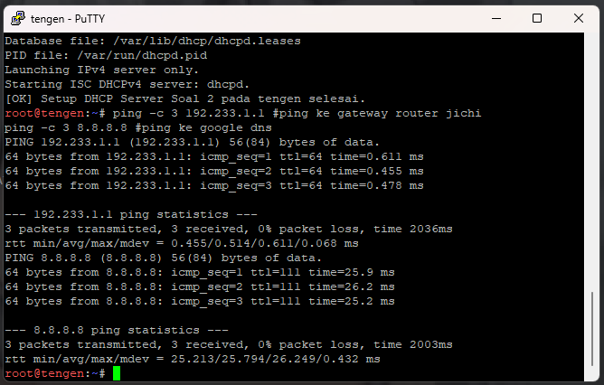
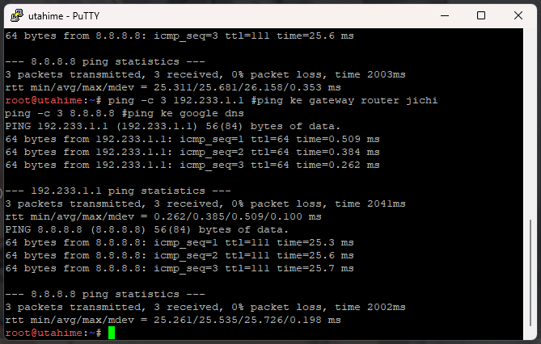
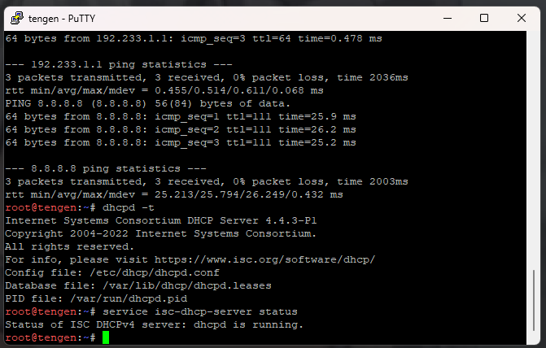
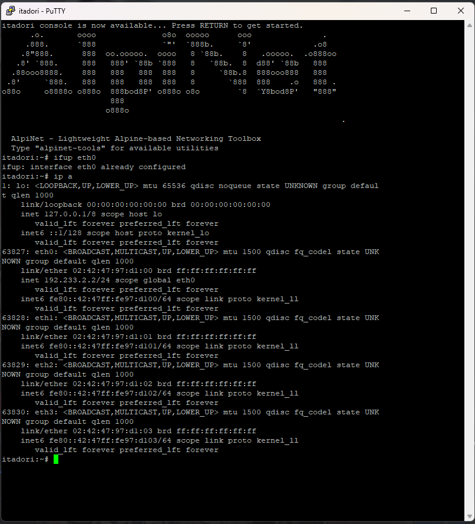
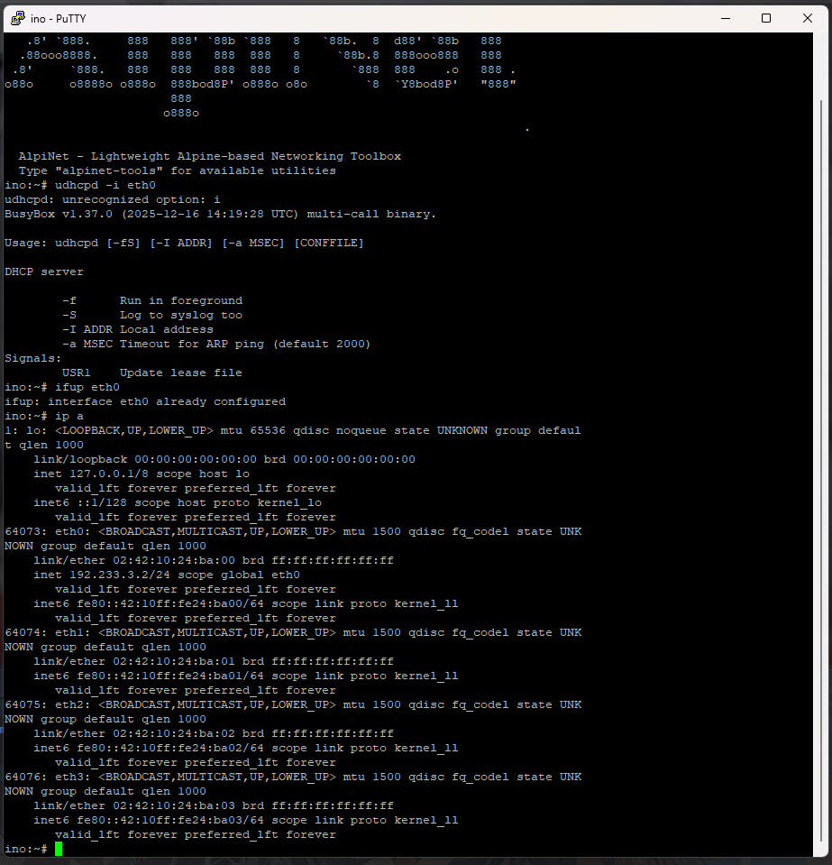
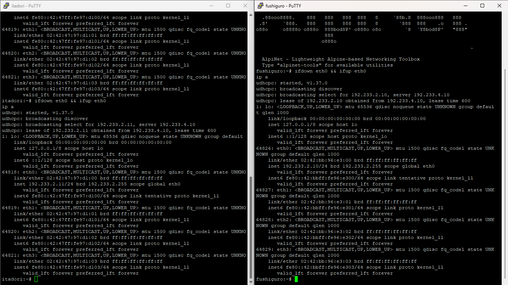
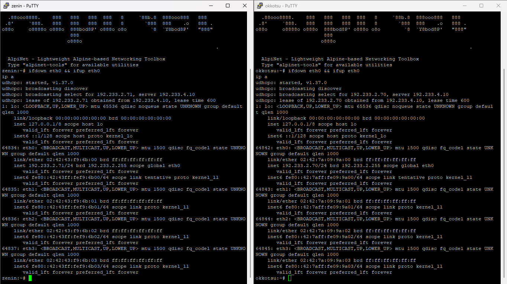
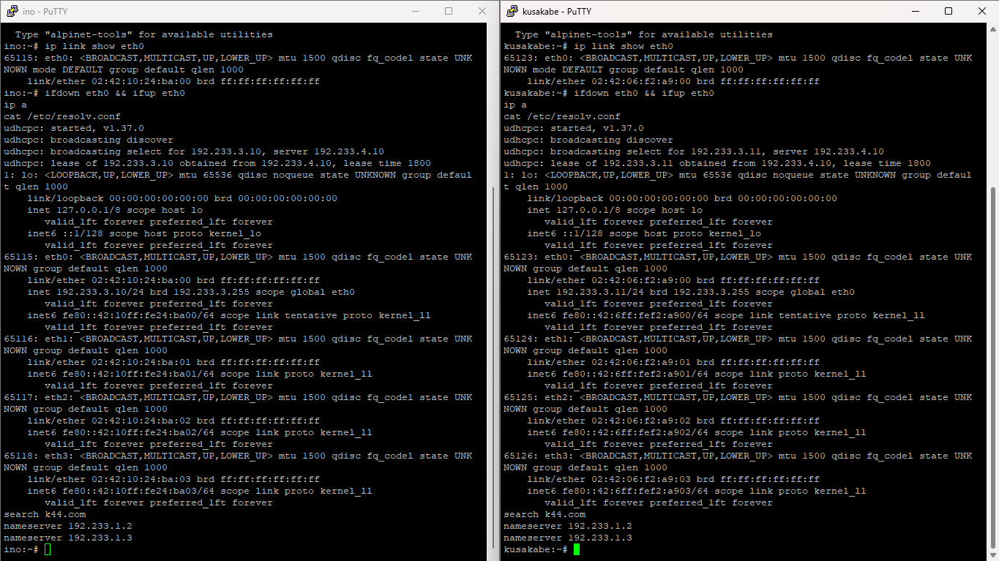
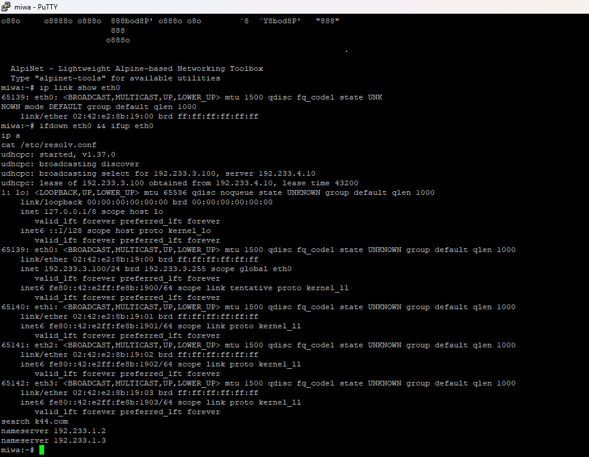
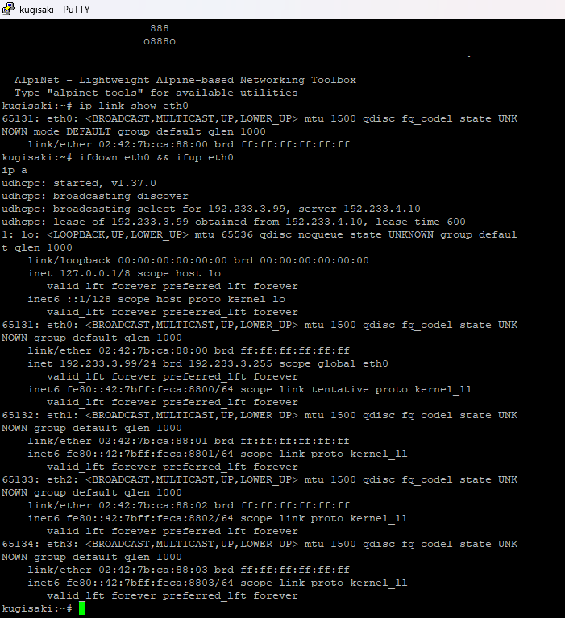

# Laporan Praktikum Jarkom Modul 3

| Nama | NRP |
| --- | --- |
| Nayarfa Syamahira Dyananta | 5027251046 |
| Rido Patra Yudhistira Edwin | 5027251120 |

---

## Konfigurasi Semua Node
```bash
# ===========================================================
# main router
# ===========================================================

# jichi
# ===========================================================
auto eth0
iface eth0 inet dhcp
	up echo "nameserver 192.168.122.1" > /etc/resolv.conf

auto eth1
iface eth1 inet static
	address 192.233.1.1
	netmask 255.255.255.0

auto eth2
iface eth2 inet static
	address 192.233.2.1
	netmask 255.255.255.0

auto eth3
iface eth3 inet static
	address 192.233.3.1
	netmask 255.255.255.0

auto eth4
iface eth4 inet static
	address 192.233.4.1
	netmask 255.255.255.0

# ===========================================================
# network 1
# ===========================================================

# utahime
# ===========================================================
auto eth0
iface eth0 inet static
	address 192.233.1.2
	netmask 255.255.255.0
	gateway 192.233.1.1

	up echo "nameserver 192.168.122.1" > /etc/resolv.conf

# shoko
# ===========================================================
auto eth0
iface eth0 inet static
	address 192.233.1.3
	netmask 255.255.255.0
	gateway 192.233.1.1

	up echo "nameserver 192.168.122.1" > /etc/resolv.conf

# gojo
# ===========================================================
auto eth0
iface eth0 inet static
	address 192.233.1.4
	netmask 255.255.255.0
	gateway 192.233.1.1

	up echo "nameserver 192.168.122.1" > /etc/resolv.conf

# ===========================================================
# network 2
# ===========================================================

# itadori
# ===========================================================
auto eth0
iface eth0 inet dhcp

# fushiguro
# ===========================================================
auto eth0
iface eth0 inet dhcp

# zenin
# ===========================================================
auto eth0
iface eth0 inet dhcp

# okkotsu
# ===========================================================
auto eth0
iface eth0 inet dhcp

# ===========================================================
# network 3
# ===========================================================

# ino
# ===========================================================
auto eth0
iface eth0 inet dhcp

# kusakabe
# ===========================================================
auto eth0
iface eth0 inet dhcp

# kugisaki
# ===========================================================
auto eth0
iface eth0 inet dhcp

# miwa
# ===========================================================
auto eth0
iface eth0 inet dhcp

# ===========================================================
# network 4
# ===========================================================

# geto
# ===========================================================
auto eth0
iface eth0 inet static
	address 192.233.4.2
	netmask 255.255.255.0
	gateway 192.233.1.1

	up echo "nameserver 192.168.122.1" > /etc/resolv.conf

# maki
# ===========================================================
auto eth0
iface eth0 inet static
	address 192.233.4.3
	netmask 255.255.255.0
	gateway 192.233.1.1

	up echo "nameserver 192.168.122.1" > /etc/resolv.conf

# panda
# ===========================================================
auto eth0
iface eth0 inet static
	address 192.233.4.4
	netmask 255.255.255.0
	gateway 192.233.1.1

	up echo "nameserver 192.168.122.1" > /etc/resolv.conf

# nanami
# ===========================================================
auto eth0
iface eth0 inet static
	address 192.233.4.5
	netmask 255.255.255.0
	gateway 192.233.1.1

	up echo "nameserver 192.168.122.1" > /etc/resolv.conf

# todo
# ===========================================================
auto eth0
iface eth0 inet static
	address 192.233.4.6
	netmask 255.255.255.0
	gateway 192.233.1.1

	up echo "nameserver 192.168.122.1" > /etc/resolv.conf

# kirara
# ===========================================================
auto eth0
iface eth0 inet static
	address 192.233.4.7
	netmask 255.255.255.0
	gateway 192.233.1.1

	up echo "nameserver 192.168.122.1" > /etc/resolv.conf

# tengen
# ===========================================================
auto eth0
iface eth0 inet static
	address 192.233.4.10
	netmask 255.255.255.0
	gateway 192.233.1.1

	up echo "nameserver 192.168.122.1" > /etc/resolv.conf

# yaga
# ===========================================================
auto eth0
iface eth0 inet static
	address 192.233.4.8
	netmask 255.255.255.0
	gateway 192.233.1.1

	up echo "nameserver 192.168.122.1" > /etc/resolv.conf


# inumaki
# ===========================================================
auto eth0
iface eth0 inet static
	address 192.233.4.9
	netmask 255.255.255.0
	gateway 192.233.1.1

	up echo "nameserver 192.168.122.1" > /etc/resolv.conf

```

---

## Soal 1: Pemulihan Konektivitas Dasar, Routing, dan NAT pada Router Jichi

### Ringkasan Soal
Mengonfigurasi router utama `jichi` agar interface `eth0` memperoleh IP WAN dari NAT secara dinamis (DHCP), serta mengonfigurasi interface `eth1` hingga `eth4` sebagai gateway untuk Network 1–4 dengan prefix IP `192.233.x.x`. Mengaktifkan *IPv4 forwarding* dan *Source NAT (MASQUERADE)* pada router `jichi`, menetapkan IP statis untuk seluruh host infrastruktur pada Network 1 dan Network 4, serta membuktikan konektivitas host ke gateway dan jaringan luar/eksternal.

---

### Apa Saja yang Harus Kita Lakukan?
1. Mengonfigurasi file `/etc/network/interfaces` pada router `jichi` untuk interface `eth0` (DHCP WAN) serta interface `eth1`–`eth4` sebagai gateway subnet lokal (`192.233.1.1/24` hingga `192.233.4.1/24`).
2. Mengonfigurasi IP statis, default gateway mengarah ke `jichi`, dan DNS resolver pada seluruh host infrastruktur di Network 1 (`utahime`, `shoko`, `gojo`) serta Network 4 (`geto`, `maki`, `panda`, `nanami`, `todo`, `kirara`, `yaga`, `inumaki`, `tengen`).
3. Membuat skrip `/root/soal-01.sh` pada router `jichi` untuk mengaktifkan `net.ipv4.ip_forward=1` dan menambahkan aturan `iptables -t nat -A POSTROUTING -o eth0 -j MASQUERADE`.
4. Memanggil skrip secara otomatis lewat perintah `up bash /root/soal-01.sh` di bawah konfigurasi `auto eth4` pada `/etc/network/interfaces` router `jichi`.
5. Melakukan verifikasi konektivitas menggunakan perintah `ping` dari host infrastruktur menuju gateway router `jichi` (`192.233.1.1`) dan IP DNS eksternal (`8.8.8.8`).

---

### Skrip Apa Saja yang Kita Gunakan?
**1. Konfigurasi `/etc/network/interfaces` di Node Router `jichi`**
```bash
auto eth0
iface eth0 inet dhcp
	up echo "nameserver 192.168.122.1" > /etc/resolv.conf

auto eth1
iface eth1 inet static
	address 192.233.1.1
	netmask 255.255.255.0

auto eth2
iface eth2 inet static
	address 192.233.2.1
	netmask 255.255.255.0

auto eth3
iface eth3 inet static
	address 192.233.3.1
	netmask 255.255.255.0

auto eth4
iface eth4 inet static
	address 192.233.4.1
	netmask 255.255.255.0

	up bash /root/soal-01.sh
```

**2. Skrip Otomatisasi IP Forwarding & NAT di Router `jichi` (`/root/soal-01.sh`)**
```bash
#!/bin/bash

# 1. Mengaktifkan IP Forwarding di tingkat kernel Linux
sysctl -w net.ipv4.ip_forward=1

# 2. Membersihkan aturan NAT lama
iptables -t nat -F

# 3. Mengaktifkan MASQUERADE pada interface WAN (eth0 yang terhubung ke NAT)
iptables -t nat -A POSTROUTING -o eth0 -j MASQUERADE
```

---

### Mekanisme Pengujian
Jalankan tes konektivitas berikut di terminal host infrastruktur (contoh pada `utahime` dan `tengen`):
```bash
# Ping ke IP gateway router jichi
ping -c 3 192.233.1.1

# Ping ke IP DNS eksternal / Google DNS untuk cek akses WAN/NAT
ping -c 3 8.8.8.8
```

---

### Hasil



*Gambar 1: Hasil pengujian ping dari node `tengen` ke gateway `192.233.1.1` dan IP publik `8.8.8.8` sukses dengan 0% packet loss.*



*Gambar 2: Hasil pengujian ping dari node `utahime` ke gateway `192.233.1.1` dan IP publik `8.8.8.8` sukses dengan 0% packet loss.*

---

## Soal 2: Konfigurasi Dasar DHCP Server Scope di Tengen

### Ringkasan Soal
Mengonfigurasi service `isc-dhcp-server` pada node Data Center `tengen` (`192.233.4.10`) untuk mengelola pengalokasian IP dinamis. Mendeklarasikan Network 4 (`192.233.4.0/24`) sebagai subnet lokal tanpa pool dinamis untuk mencegah munculnya error *"No subnet declaration for eth0"*, serta menyiapkan deklarasi *scope* DHCP untuk Network 2 (`192.233.2.0/24`) dan Network 3 (`192.233.3.0/24`). Memvalidasi sintaks konfigurasi dan memastikan service `isc-dhcp-server` berjalan dengan status aktif.

---

### Apa Saja yang Harus Kita Lakukan?
1. Menginstal paket `isc-dhcp-server` pada node `tengen`.
2. Mengonfigurasi file `/etc/default/isc-dhcp-server` agar *service* mendengarkan permintaan DHCP pada interface `eth0`.
3. Mengonfigurasi file `/etc/dhcp/dhcpd.conf` dengan mendeklarasikan subnet lokal Network 4 (`192.233.4.0/24`) tanpa pool dinamis, serta deklarasi *scope* subnet untuk Network 2 (`192.233.2.0/24`) dan Network 3 (`192.233.3.0/24`).
4. Membuat skrip otomatisasi `/root/soal-02.sh` pada node `tengen` untuk mengaplikasikan seluruh konfigurasi dan melakukan *restart service*.
5. Memanggil skrip otomatisasi melalui baris perintah `up bash /root/soal-02.sh` pada file `/etc/network/interfaces` di node `tengen`.
6. Memeriksa keabsahan sintaks konfigurasi menggunakan perintah `dhcpd -t` dan mengonfirmasi status service dengan perintah `service isc-dhcp-server status`.

---

### Skrip Apa Saja yang Kita Gunakan?
**1. Skrip Otomatisasi DHCP Server di Node `tengen` (`/root/soal-02.sh`)**
```bash
#!/bin/bash
# ========================================================
# Script Soal 2 - Setup DHCP Server Scope (tengen)
# Kelompok: K44 | Prefix: 192.233.x.x
# ========================================================

# 1. Update paket & Install isc-dhcp-server
apt-get update
apt-get install -y isc-dhcp-server

# 2. Atur interface tempat DHCP Server mendengarkan request (eth0)
cat <<EOF > /etc/default/isc-dhcp-server
INTERFACESv4="eth0"
INTERFACESv6=""
EOF

# 3. Konfigurasi /etc/dhcp/dhcpd.conf
cat <<EOF > /etc/dhcp/dhcpd.conf
# Global Configuration
authoritative;
default-lease-time 600;
max-lease-time 7200;

# A. Subnet Lokal Network 4 (Data Center) - TANPA POOL DINAMIS
# Wajib dideklarasikan agar tidak muncul error "No subnet declaration for eth0"
subnet 192.233.4.0 netmask 255.255.255.0 {
    option routers 192.233.4.1;
    option broadcast-address 192.233.4.255;
}

# B. Scope DHCP Network 2 (Divisi A)
subnet 192.233.2.0 netmask 255.255.255.0 {
    option routers 192.233.2.1;
    option broadcast-address 192.233.2.255;
}

# C. Scope DHCP Network 3 (Divisi B)
subnet 192.233.3.0 netmask 255.255.255.0 {
    option routers 192.233.3.1;
    option broadcast-address 192.233.3.255;
}
EOF

# 4. Validasi sintaks konfigurasi
dhcpd -t -cf /etc/dhcp/dhcpd.conf

# 5. Restart dan aktifkan service isc-dhcp-server
service isc-dhcp-server restart

echo "[OK] Setup DHCP Server Soal 2 pada tengen selesai."
```

**2. Konfigurasi `/etc/network/interfaces` di Node `tengen`**
```bash
auto eth0
iface eth0 inet static
	address 192.233.4.10
	netmask 255.255.255.0
	gateway 192.233.1.1

	up echo "nameserver 192.168.122.1" > /etc/resolv.conf
	up bash /root/soal-02.sh
```

---

### Mekanisme Pengujian
Eksekusi perintah berikut pada terminal node **`tengen`**:
```bash
# Validasi sintaks file konfigurasi dhcpd.conf
dhcpd -t

# Verifikasi status operasional service isc-dhcp-server
service isc-dhcp-server status
```

---

### Hasil



*Gambar 1: Hasil pengecekan sintaks `dhcpd -t` tanpa error dan verifikasi status service `isc-dhcp-server` yang menunjukkan `dhcpd is running` pada node `tengen`.*

---

## Soal 3: Konfigurasi DHCP Relay pada Router Jichi

### Ringkasan Soal
Mengonfigurasi router `jichi` sebagai *DHCP Relay Agent* untuk meneruskan *broadcast request* DHCP dari Network 2 (Divisi A melalui interface `eth2`) dan Network 3 (Divisi B melalui interface `eth3`) menuju DHCP Server `tengen` (`192.233.4.10`) yang terhubung pada interface `eth4`. Membuktikan bahwa client dari kedua subnet (seperti `itadori` di Network 2 dan `ino` di Network 3) berhasil memperoleh alokasi alamat IP dinamis secara otomatis melalui *relay*.

---

### Apa Saja yang Harus Kita Lakukan?
1. Menginstal paket `isc-dhcp-relay` pada router `jichi`.
2. Mengonfigurasi file `/etc/default/isc-dhcp-relay` dengan menetapkan `SERVERS="192.233.4.10"` (IP `tengen`) serta menentukan interface listener `INTERFACES="eth2 eth3 eth4"`.
3. Memastikan *IPv4 Forwarding* (`net.ipv4.ip_forward=1`) tetap aktif pada router `jichi`.
4. Membuat skrip otomatisasi `/root/soal-03.sh` pada router `jichi` dan meregistrasikannya ke dalam file `/etc/network/interfaces` dengan perintah `up bash /root/soal-03.sh`.
5. Melakukan pengujian pada client `itadori` (Network 2) dan `ino` (Network 3) menggunakan perintah `ifup eth0` lalu mengecek perolehan IP dinamis menggunakan `ip a`.

---

### Skrip Apa Saja yang Kita Gunakan?
**1. Skrip Otomatisasi DHCP Relay di Router `jichi` (`/root/soal-03.sh`)**
```bash
#!/bin/bash
# ========================================================
# Script Soal 3 - Setup DHCP Relay (jichi)
# Kelompok: K44 | Prefix: 192.233
# ========================================================

# 1. Update paket & Install isc-dhcp-relay
apt-get update
DEBIAN_FRONTEND=noninteractive apt-get install -y isc-dhcp-relay

# 2. Konfigurasi /etc/default/isc-dhcp-relay
# SERVERS: Alamat IP DHCP Server (tengen)
# INTERFACES: Interface client (eth2, eth3) + interface menuju server (eth4)
cat <<EOF > /etc/default/isc-dhcp-relay
SERVERS="192.233.4.10"
INTERFACES="eth2 eth3 eth4"
OPTIONS=""
EOF

# 3. Pastikan IP Forwarding tetap aktif
sysctl -w net.ipv4.ip_forward=1

# 4. Restart service DHCP Relay
service isc-dhcp-relay restart

echo "[OK] Setup DHCP Relay Soal 3 pada jichi selesai."
```

**2. Konfigurasi `/etc/network/interfaces` di Node Router `jichi`**
```bash
auto eth0
iface eth0 inet dhcp
	up echo "nameserver 192.168.122.1" > /etc/resolv.conf

auto eth1
iface eth1 inet static
	address 192.233.1.1
	netmask 255.255.255.0

auto eth2
iface eth2 inet static
	address 192.233.2.1
	netmask 255.255.255.0

auto eth3
iface eth3 inet static
	address 192.233.3.1
	netmask 255.255.255.0

auto eth4
iface eth4 inet static
	address 192.233.4.1
	netmask 255.255.255.0

	up bash /root/soal-01.sh
	up bash /root/soal-03.sh
```

---

### Mekanisme Pengujian
Eksekusi perintah berikut pada terminal client Network 2 (`itadori`) dan Network 3 (`ino`):
```bash
# Mengaktifkan interface jaringan client
ifup eth0

# Memeriksa perolehan alamat IP dari DHCP Server melalui relay
ip a
```

---

### Hasil



*Gambar 1: Hasil pengujian pada node `itadori` (Network 2) yang berhasil mendapatkan alokasi IP dinamis `192.233.2.2/24` dari DHCP Server via relay `jichi`.*



*Gambar 2: Hasil pengujian pada node `ino` (Network 3) yang berhasil mendapatkan alokasi IP dinamis `192.233.3.2/24` dari DHCP Server via relay `jichi`.*

---

## Soal 4: Pembagian Class Pool DHCP Berdasarkan MAC Address pada Network 2 (Divisi A)

### Ringkasan Soal
Mengatur pembagian alokasi alamat IP dinamis pada Network 2 (Divisi A) menjadi dua *pool* terpisah dalam satu subnet yang sama. Menggunakan fitur *DHCP Class* berdasarkan pencocokan MAC Address fisik client. *Pool 1* (`192.233.2.10`–`192.233.2.35`) dialokasikan khusus untuk Tim Dev (`itadori` dan `fushiguro`), sedangkan *Pool 2* (`192.233.2.70`–`192.233.2.95`) dialokasikan khusus untuk Tim Support (`zenin` dan `okkotsu`). Rentang `192.233.2.36`–`192.233.2.69` dikosongkan dan dilarang dialokasikan.

---

### Apa Saja yang Harus Kita Lakukan?
1. Mengidentifikasi MAC Address fisik interface `eth0` dari masing-masing client di Divisi A (`itadori`, `fushiguro`, `zenin`, `okkotsu`) menggunakan perintah `ip link show eth0`.
2. Mendefinisikan class `pool1_dev` pada file `/etc/dhcp/dhcpd.conf` di node `tengen` untuk mencocokkan MAC Address `itadori` (`02:42:47:97:d1:00`) dan `fushiguro` (`02:42:bb:96:e3:00`).
3. Mendefinisikan class `pool2_support` pada file `/etc/dhcp/dhcpd.conf` di node `tengen` untuk mencocokkan MAC Address `zenin` (`02:42:43:f9:6b:00`) dan `okkotsu` (`02:42:7a:09:9a:00`).
4. Mengonfigurasi blok `subnet 192.233.2.0 netmask 255.255.255.0` dengan menambahkan dua aturan `pool`:
    * Pool 1: `allow members of "pool1_dev";` dengan `range 192.233.2.10 192.233.2.35;`
    * Pool 2: `allow members of "pool2_support";` dengan `range 192.233.2.70 192.233.2.95;`
5. Membuat skrip otomatisasi `/root/soal-04.sh` pada node `tengen` dan memperbarui panggilan skrip pada `/etc/network/interfaces`.
6. Memperbarui perolehan lease pada keempat client Divisi A menggunakan perintah `ifdown eth0 && ifup eth0` lalu memverifikasi alokasi IP masing-masing menggunakan `ip a`.

---

### Skrip Apa Saja yang Kita Gunakan?
**1. Skrip Otomatisasi Class Pool DHCP Network 2 di Node `tengen` (`/root/soal-04.sh`)**
```bash
#!/bin/bash
# ========================================================
# Script Soal 4 - Setup DHCP Class Pool Network 2 (tengen)
# Kelompok: K44 | Prefix: 192.233
# ========================================================

cat <<EOF > /etc/dhcp/dhcpd.conf
authoritative;
default-lease-time 600;
max-lease-time 7200;

# Class Pool 1 (Tim Dev: itadori & fushiguro)
class "pool1_dev" {
    match if (
        substring(hardware, 1, 6) = 02:42:47:97:d1:00 or
        substring(hardware, 1, 6) = 02:42:bb:96:e3:00
    );
}

# Class Pool 2 (Tim Support: zenin & okkotsu)
class "pool2_support" {
    match if (
        substring(hardware, 1, 6) = 02:42:43:f9:6b:00 or
        substring(hardware, 1, 6) = 02:42:7a:09:9a:00
    );
}

# Subnet Lokal Network 4 (Data Center)
subnet 192.233.4.0 netmask 255.255.255.0 {
    option routers 192.233.4.1;
    option broadcast-address 192.233.4.255;
}

# Subnet Network 2 (Divisi A)
subnet 192.233.2.0 netmask 255.255.255.0 {
    option routers 192.233.2.1;
    option broadcast-address 192.233.2.255;

    # Pool 1: 192.233.2.10 - 192.233.2.35
    pool {
        allow members of "pool1_dev";
        range 192.233.2.10 192.233.2.35;
    }

    # Pool 2: 192.233.2.70 - 192.233.2.95
    pool {
        allow members of "pool2_support";
        range 192.233.2.70 192.233.2.95;
    }
}

# Subnet Network 3 (Divisi B)
subnet 192.233.3.0 netmask 255.255.255.0 {
    option routers 192.233.3.1;
    option broadcast-address 192.233.3.255;
}
EOF

# Validasi & Restart
dhcpd -t -cf /etc/dhcp/dhcpd.conf
service isc-dhcp-server restart

echo "[OK] DHCP Class Pool Soal 4 berhasil diperbarui di tengen."
```

**2. Konfigurasi `/etc/network/interfaces` di Node `tengen`**
```bash
auto eth0
iface eth0 inet static
	address 192.233.4.10
	netmask 255.255.255.0
	gateway 192.233.4.1

	up echo "nameserver 192.168.122.1" > /etc/resolv.conf

	up bash /root/soal-02.sh
	up bash /root/soal-04.sh
```

---

### Mekanisme Pengujian
Eksekusi perintah berikut pada setiap terminal client Divisi A (`itadori`, `fushiguro`, `zenin`, `okkotsu`):
```bash
# Memperbarui permintaan lease IP dari DHCP Server
ifdown eth0 && ifup eth0

# Memeriksa perolehan alamat IP dari pool yang sesuai
ip a
```

---

### Hasil



*Gambar 1: Hasil pengujian pada `itadori` (mendapatkan IP `192.233.2.11`) dan `fushiguro` (mendapatkan IP `192.233.2.10`) yang terbukti berada dalam rentang Pool 1 Dev (`192.233.2.10`–`192.233.2.35`).*



*Gambar 2: Hasil pengujian pada `zenin` (mendapatkan IP `192.233.2.71`) dan `okkotsu` (mendapatkan IP `192.233.2.70`) yang terbukti berada dalam rentang Pool 2 Support (`192.233.2.70`–`192.233.2.95`).*

---

## Soal 5: Konfigurasi Short Lease & Long Lease DHCP serta Options DNS/Domain pada Network 3 (Divisi B)

### Ringkasan Soal
Mengonfigurasi pengaturan DHCP pada Network 3 (Divisi B) dengan dua kebijakan durasi *lease* yang berbeda menggunakan klasifikasi *DHCP Class* berdasarkan MAC Address. Memberikan *short lease* selama 30 menit (1800 detik) dari pool `192.233.3.10`–`192.233.3.89` kepada `ino` dan `kusakabe`, serta *long lease* selama 12 jam (43200 detik) dari pool `192.233.3.100`–`192.233.3.199` kepada `miwa`. Selain itu, memberikan konfigurasi DHCP Options berupa DNS server `192.233.1.2` & `192.233.1.3` serta *domain search / domain name* `k44.com`.

---

### Apa Saja yang Harus Kita Lakukan?
1. Mengidentifikasi MAC Address fisik interface `eth0` milik client Divisi B (`ino`, `kusakabe`, `miwa`) menggunakan perintah `ip link show eth0`.
2. Mendefinisikan class `short_lease_class` pada file `/etc/dhcp/dhcpd.conf` di node `tengen` untuk mencocokkan MAC Address `ino` (`02:42:10:24:ba:00`) dan `kusakabe` (`02:42:06:f2:a9:00`).
3. Mendefinisikan class `long_lease_class` pada file `/etc/dhcp/dhcpd.conf` di node `tengen` untuk mencocokkan MAC Address `miwa` (`02:42:e2:8b:19:00`).
4. Mengonfigurasi blok `subnet 192.233.3.0 netmask 255.255.255.0` pada file `dhcpd.conf` dengan mengaktifkan opsi DNS server `192.233.1.2, 192.233.1.3` dan domain `k44.com`.
5. Menambahkan dua aturan *pool* di dalam subnet Network 3:
    * Pool *Short Lease*: `allow members of "short_lease_class";` dengan `range 192.233.3.10 192.233.3.89;`, `default-lease-time 1800;`, dan `max-lease-time 1800;`.
    * Pool *Long Lease*: `allow members of "long_lease_class";` dengan `range 192.233.3.100 192.233.3.199;`, `default-lease-time 43200;`, dan `max-lease-time 43200;`.
6. Membuat skrip otomatisasi `/root/soal-05.sh` pada node `tengen` dan meregistrasikan eksekusinya pada file `/etc/network/interfaces`.
7. Memperbarui perolehan lease pada client Network 3 (`ino`, `kusakabe`, `miwa`) dengan perintah `ifdown eth0 && ifup eth0`, kemudian mengecek perolehan IP, *lease time*, dan entri DNS resolver menggunakan perintah `ip a` serta `cat /etc/resolv.conf`.

---

### Skrip Apa Saja yang Kita Gunakan?
**1. Skrip Otomatisasi DHCP Scope Network 3 di Node `tengen` (`/root/soal-05.sh`)**
```bash
#!/bin/bash
# ========================================================
# Script Soal 5 - Setup DHCP Scope Network 3 (tengen)
# Kelompok: K44 | Prefix: 192.233 | Domain: k44.com
# ========================================================

# MAC Address Client Network 3
MAC_INO="02:42:10:24:ba:00"
MAC_KUSAKABE="02:42:06:f2:a9:00"
MAC_MIWA="02:42:e2:8b:19:00"

cat <<EOF > /etc/dhcp/dhcpd.conf
authoritative;
default-lease-time 600;
max-lease-time 7200;

# --- CLASS DIVISI A (NETWORK 2 - SOAL 4) ---
class "pool1_dev" {
    match if hardware = 1:02:42:47:97:d1:00 or hardware = 1:02:42:bb:96:e3:00;
}

class "pool2_support" {
    match if hardware = 1:02:42:43:f9:6b:00 or hardware = 1:02:42:7a:09:9a:00;
}

# --- CLASS DIVISI B (NETWORK 3 - SOAL 5) ---
class "short_lease_class" {
    match if hardware = 1:$MAC_INO or hardware = 1:$MAC_KUSAKABE;
}

class "long_lease_class" {
    match if hardware = 1:$MAC_MIWA;
}

# Subnet Lokal Network 4 (Data Center)
subnet 192.233.4.0 netmask 255.255.255.0 {
    option routers 192.233.4.1;
    option broadcast-address 192.233.4.255;
}

# Subnet Network 2 (Divisi A)
subnet 192.233.2.0 netmask 255.255.255.0 {
    option routers 192.233.2.1;
    option broadcast-address 192.233.2.255;

    pool {
        allow members of "pool1_dev";
        range 192.233.2.10 192.233.2.35;
    }

    pool {
        allow members of "pool2_support";
        range 192.233.2.70 192.233.2.95;
    }
}

# Subnet Network 3 (Divisi B) - SOAL 5
subnet 192.233.3.0 netmask 255.255.255.0 {
    option routers 192.233.3.1;
    option broadcast-address 192.233.3.255;

    # DHCP Options Soal 5
    option domain-name-servers 192.233.1.2, 192.233.1.3;
    option domain-name "k44.com";
    option domain-search "k44.com";

    # Pool Short Lease (ino & kusakabe) - 30 menit (1800 detik)
    pool {
        allow members of "short_lease_class";
        range 192.233.3.10 192.233.3.89;
        default-lease-time 1800;
        max-lease-time 1800;
    }

    # Pool Long Lease (miwa) - 12 jam (43200 detik)
    pool {
        allow members of "long_lease_class";
        range 192.233.3.100 192.233.3.199;
        default-lease-time 43200;
        max-lease-time 43200;
    }
}
EOF

# Validasi & Restart Service
dhcpd -t -cf /etc/dhcp/dhcpd.conf
service isc-dhcp-server restart

echo "[OK] Setup DHCP Soal 5 berhasil dikonfigurasi di tengen."
```

**2. Konfigurasi `/etc/network/interfaces` di Node `tengen`**
```bash
auto eth0
iface eth0 inet static
	address 192.233.4.10
	netmask 255.255.255.0
	gateway 192.233.4.1

	up echo "nameserver 192.168.122.1" > /etc/resolv.conf

	up bash /root/soal-02.sh
	up bash /root/soal-04.sh
	up bash /root/soal-05.sh
```

---

### Mekanisme Pengujian
Eksekusi perintah berikut pada terminal client Network 3 (`ino`, `kusakabe`, `miwa`):
```bash
# Memperbarui perolehan lease IP dari DHCP Server
ifdown eth0 && ifup eth0

# Memeriksa perolehan alamat IP dan durasi lease time
ip a

# Memeriksa entri DNS nameserver dan search domain yang dikirim DHCP Server
cat /etc/resolv.conf
```

---

### Hasil



*Gambar 1: Hasil pengujian pada client `ino` (IP `192.233.3.10`) dan `kusakabe` (IP `192.233.3.11`) yang mendapatkan lease time 1800 detik (30 menit) serta opsi DNS `192.233.1.2`, `192.233.1.3`, dan domain-search `k44.com`.*



*Gambar 2: Hasil pengujian pada client `miwa` (IP `192.233.3.100`) yang mendapatkan lease time 43200 detik (12 jam) dari pool long lease serta opsi DNS dan domain-search yang sesuai.*

---

## Soal 6: Konfigurasi DHCP Static Lease (Fixed Address VIP) untuk Kugisaki

### Ringkasan Soal
Mengonfigurasi reservasi alamat IP tetap (*Static Lease / Fixed Address*) pada DHCP Server `tengen` untuk client `kugisaki` sebagai personel VIP. Reservasi dilakukan berdasarkan entri MAC Address fisik interface `eth0` milik `kugisaki` untuk mengalokasikan IP spesifik `192.233.3.99`. Dipastikan alamat IP `192.233.3.99` berada di luar rentang pool dinamis Network 3 (*short lease* `192.233.3.10`–`192.233.3.89` dan *long lease* `192.233.3.100`–`192.233.3.199`). Pengujian dilakukan dengan memperbarui lease pada client `kugisaki` untuk membuktikan perolehan alamat IP statis yang telah didedikasikan.

---

### Apa Saja yang Harus Kita Lakukan?
1. Mengidentifikasi MAC Address fisik interface `eth0` pada client `kugisaki` menggunakan perintah `ip link show eth0` (`02:42:7b:ca:88:00`).
2. Menambahkan deklarasi blok `host kugisaki_vip` pada file `/etc/dhcp/dhcpd.conf` di node `tengen` dengan parameter `hardware ethernet 02:42:7b:ca:88:00;` dan `fixed-address 192.233.3.99;`.
3. Memastikan IP `192.233.3.99` berada di celah antara *short lease pool* dan *long lease pool* agar tidak bentrok dengan alokasi IP dinamis client lain.
4. Membuat skrip otomatisasi `/root/soal-06.sh` pada node `tengen` dan menambahkan pemanggilannya pada file `/etc/network/interfaces`.
5. Memvalidasi konfigurasi dengan `dhcpd -t -cf /etc/dhcp/dhcpd.conf` dan merestart service `isc-dhcp-server`.
6. Memperbarui permintaan lease pada client `kugisaki` menggunakan perintah `ifdown eth0 && ifup eth0` lalu mengecek alamat IP yang diterima menggunakan perintah `ip a`.

---

### Skrip Apa Saja yang Kita Gunakan?
**1. Skrip Otomatisasi Static Lease VIP Kugisaki di Node `tengen` (`/root/soal-06.sh`)**
```bash
#!/bin/bash
# ========================================================
# Script Soal 6 - Setup Static Lease VIP kugisaki (tengen)
# Kelompok: K44 | Prefix: 192.233 | Domain: k44.com
# ========================================================

# MAC Address Client Network 3
MAC_INO="02:42:10:24:ba:00"
MAC_KUSAKABE="02:42:06:f2:a9:00"
MAC_MIWA="02:42:e2:8b:19:00"

# MAC Address VIP kugisaki
MAC_KUGISAKI="02:42:7b:ca:88:00"

cat <<EOF > /etc/dhcp/dhcpd.conf
authoritative;
default-lease-time 600;
max-lease-time 7200;

# --- CLASS DIVISI A (NETWORK 2 - SOAL 4) ---
class "pool1_dev" {
    match if hardware = 1:02:42:47:97:d1:00 or hardware = 1:02:42:bb:96:e3:00;
}

class "pool2_support" {
    match if hardware = 1:02:42:43:f9:6b:00 or hardware = 1:02:42:7a:09:9a:00;
}

# --- CLASS DIVISI B (NETWORK 3 - SOAL 5) ---
class "short_lease_class" {
    match if hardware = 1:$MAC_INO or hardware = 1:$MAC_KUSAKABE;
}

class "long_lease_class" {
    match if hardware = 1:$MAC_MIWA;
}

# --- STATIC LEASE VIP (NETWORK 3 - SOAL 6) ---
host kugisaki_vip {
    hardware ethernet $MAC_KUGISAKI;
    fixed-address 192.233.3.99;
}

# Subnet Lokal Network 4 (Data Center)
subnet 192.233.4.0 netmask 255.255.255.0 {
    option routers 192.233.4.1;
    option broadcast-address 192.233.4.255;
}

# Subnet Network 2 (Divisi A)
subnet 192.233.2.0 netmask 255.255.255.0 {
    option routers 192.233.2.1;
    option broadcast-address 192.233.2.255;

    pool {
        allow members of "pool1_dev";
        range 192.233.2.10 192.233.2.35;
    }

    pool {
        allow members of "pool2_support";
        range 192.233.2.70 192.233.2.95;
    }
}

# Subnet Network 3 (Divisi B)
subnet 192.233.3.0 netmask 255.255.255.0 {
    option routers 192.233.3.1;
    option broadcast-address 192.233.3.255;

    option domain-name-servers 192.233.1.2, 192.233.1.3;
    option domain-name "k44.com";
    option domain-search "k44.com";

    # Pool Short Lease (ino & kusakabe)
    pool {
        allow members of "short_lease_class";
        range 192.233.3.10 192.233.3.89;
        default-lease-time 1800;
        max-lease-time 1800;
    }

    # Pool Long Lease (miwa)
    pool {
        allow members of "long_lease_class";
        range 192.233.3.100 192.233.3.199;
        default-lease-time 43200;
        max-lease-time 43200;
    }
}
EOF

# Validasi & Restart Service
dhcpd -t -cf /etc/dhcp/dhcpd.conf
service isc-dhcp-server restart

echo "[OK] Setup Static Lease VIP Soal 6 berhasil di tengen."
```

**2. Konfigurasi `/etc/network/interfaces` di Node `tengen`**
```bash
auto eth0
iface eth0 inet static
	address 192.233.4.10
	netmask 255.255.255.0
	gateway 192.233.4.1

	up echo "nameserver 192.168.122.1" > /etc/resolv.conf

	up bash /root/soal-02.sh
	up bash /root/soal-04.sh
	up bash /root/soal-05.sh
	up bash /root/soal-06.sh
```

---

### Mekanisme Pengujian
Eksekusi perintah berikut pada terminal client VIP `kugisaki`:
```bash
# Memperbarui permintaan lease IP dari DHCP Server
ifdown eth0 && ifup eth0

# Memeriksa perolehan alamat IP statis yang dialokasikan
ip a
```

---

### Hasil



*Gambar 1: Hasil pengujian pada node `kugisaki` yang berhasil mendapatkan alokasi IP statis VIP `192.233.3.99/24` dari DHCP Server `tengen` sesuai dengan konfigurasi fixed-address.*

---

## Soal 7: XXX

### Ringkasan Soal
xxx

---

### Apa Saja yang Harus Kita Lakukan?
1. xxx

---

### Skrip Apa Saja yang Kita Gunakan?
```bash

```

---

### Mekanisme Pengujian
```bash

```

---

### Hasil


---

## Soal 8: XXX

### Ringkasan Soal
xxx

---

### Apa Saja yang Harus Kita Lakukan?
1. xxx

---

### Skrip Apa Saja yang Kita Gunakan?
```bash

```

---

### Mekanisme Pengujian
```bash

```

---

### Hasil


---

## Soal 9: XXX

### Ringkasan Soal
xxx

---

### Apa Saja yang Harus Kita Lakukan?
1. xxx

---

### Skrip Apa Saja yang Kita Gunakan?
```bash

```

---

### Mekanisme Pengujian
```bash

```

---

### Hasil


---

## Soal 10: XXX

### Ringkasan Soal
xxx

---

### Apa Saja yang Harus Kita Lakukan?
1. xxx

---

### Skrip Apa Saja yang Kita Gunakan?
```bash

```

---

### Mekanisme Pengujian
```bash

```

---

### Hasil


---