# Laporan Praktikum Jarkom Modul 3

| Nama | NRP |
| --- | --- |
| Nayarfa Syamahira Dyananta | 5027251046 |
| Rido Patra Yudhistira Edwin | 5027251120 |

---

## Konfigurasi Semua Node
```bash
# ===========================================================
# main router
# ===========================================================

# jichi
# ===========================================================
auto eth0
iface eth0 inet dhcp
	up echo "nameserver 192.168.122.1" > /etc/resolv.conf

auto eth1
iface eth1 inet static
	address 192.233.1.1
	netmask 255.255.255.0

auto eth2
iface eth2 inet static
	address 192.233.2.1
	netmask 255.255.255.0

auto eth3
iface eth3 inet static
	address 192.233.3.1
	netmask 255.255.255.0

auto eth4
iface eth4 inet static
	address 192.233.4.1
	netmask 255.255.255.0

# ===========================================================
# network 1
# ===========================================================

# utahime
# ===========================================================
auto eth0
iface eth0 inet static
	address 192.233.1.2
	netmask 255.255.255.0
	gateway 192.233.1.1

	up echo "nameserver 192.168.122.1" > /etc/resolv.conf

# shoko
# ===========================================================
auto eth0
iface eth0 inet static
	address 192.233.1.3
	netmask 255.255.255.0
	gateway 192.233.1.1

	up echo "nameserver 192.168.122.1" > /etc/resolv.conf

# gojo
# ===========================================================
auto eth0
iface eth0 inet static
	address 192.233.1.4
	netmask 255.255.255.0
	gateway 192.233.1.1

	up echo "nameserver 192.168.122.1" > /etc/resolv.conf

# ===========================================================
# network 2
# ===========================================================

# itadori
# ===========================================================
auto eth0
iface eth0 inet dhcp

# fushiguro
# ===========================================================
auto eth0
iface eth0 inet dhcp

# zenin
# ===========================================================
auto eth0
iface eth0 inet dhcp

# okkotsu
# ===========================================================
auto eth0
iface eth0 inet dhcp

# ===========================================================
# network 3
# ===========================================================

# ino
# ===========================================================
auto eth0
iface eth0 inet dhcp

# kusakabe
# ===========================================================
auto eth0
iface eth0 inet dhcp

# kugisaki
# ===========================================================
auto eth0
iface eth0 inet dhcp

# miwa
# ===========================================================
auto eth0
iface eth0 inet dhcp

# ===========================================================
# network 4
# ===========================================================

# geto
# ===========================================================
auto eth0
iface eth0 inet static
	address 192.233.4.2
	netmask 255.255.255.0
	gateway 192.233.1.1

	up echo "nameserver 192.168.122.1" > /etc/resolv.conf

# maki
# ===========================================================
auto eth0
iface eth0 inet static
	address 192.233.4.3
	netmask 255.255.255.0
	gateway 192.233.1.1

	up echo "nameserver 192.168.122.1" > /etc/resolv.conf

# panda
# ===========================================================
auto eth0
iface eth0 inet static
	address 192.233.4.4
	netmask 255.255.255.0
	gateway 192.233.1.1

	up echo "nameserver 192.168.122.1" > /etc/resolv.conf

# nanami
# ===========================================================
auto eth0
iface eth0 inet static
	address 192.233.4.5
	netmask 255.255.255.0
	gateway 192.233.1.1

	up echo "nameserver 192.168.122.1" > /etc/resolv.conf

# todo
# ===========================================================
auto eth0
iface eth0 inet static
	address 192.233.4.6
	netmask 255.255.255.0
	gateway 192.233.1.1

	up echo "nameserver 192.168.122.1" > /etc/resolv.conf

# kirara
# ===========================================================
auto eth0
iface eth0 inet static
	address 192.233.4.7
	netmask 255.255.255.0
	gateway 192.233.1.1

	up echo "nameserver 192.168.122.1" > /etc/resolv.conf

# tengen
# ===========================================================
auto eth0
iface eth0 inet static
	address 192.233.4.10
	netmask 255.255.255.0
	gateway 192.233.1.1

	up echo "nameserver 192.168.122.1" > /etc/resolv.conf

# yaga
# ===========================================================
auto eth0
iface eth0 inet static
	address 192.233.4.8
	netmask 255.255.255.0
	gateway 192.233.1.1

	up echo "nameserver 192.168.122.1" > /etc/resolv.conf


# inumaki
# ===========================================================
auto eth0
iface eth0 inet static
	address 192.233.4.9
	netmask 255.255.255.0
	gateway 192.233.1.1

	up echo "nameserver 192.168.122.1" > /etc/resolv.conf

```

---

## Soal 1: Pemulihan Konektivitas Dasar, Routing, dan NAT pada Router Jichi

### Ringkasan Soal
Mengonfigurasi router utama `jichi` agar interface `eth0` memperoleh IP WAN dari NAT secara dinamis (DHCP), serta mengonfigurasi interface `eth1` hingga `eth4` sebagai gateway untuk Network 1–4 dengan prefix IP `192.233.x.x`. Mengaktifkan *IPv4 forwarding* dan *Source NAT (MASQUERADE)* pada router `jichi`, menetapkan IP statis untuk seluruh host infrastruktur pada Network 1 dan Network 4, serta membuktikan konektivitas host ke gateway dan jaringan luar/eksternal.

---

### Apa Saja yang Harus Kita Lakukan?
1. Mengonfigurasi file `/etc/network/interfaces` pada router `jichi` untuk interface `eth0` (DHCP WAN) serta interface `eth1`–`eth4` sebagai gateway subnet lokal (`192.233.1.1/24` hingga `192.233.4.1/24`).
2. Mengonfigurasi IP statis, default gateway mengarah ke `jichi`, dan DNS resolver pada seluruh host infrastruktur di Network 1 (`utahime`, `shoko`, `gojo`) serta Network 4 (`geto`, `maki`, `panda`, `nanami`, `todo`, `kirara`, `yaga`, `inumaki`, `tengen`).
3. Membuat skrip `/root/soal-01.sh` pada router `jichi` untuk mengaktifkan `net.ipv4.ip_forward=1` dan menambahkan aturan `iptables -t nat -A POSTROUTING -o eth0 -j MASQUERADE`.
4. Memanggil skrip secara otomatis lewat perintah `up bash /root/soal-01.sh` di bawah konfigurasi `auto eth4` pada `/etc/network/interfaces` router `jichi`.
5. Melakukan verifikasi konektivitas menggunakan perintah `ping` dari host infrastruktur menuju gateway router `jichi` (`192.233.1.1`) dan IP DNS eksternal (`8.8.8.8`).

---

### Skrip Apa Saja yang Kita Gunakan?
**1. Konfigurasi `/etc/network/interfaces` di Node Router `jichi`**
```bash
auto eth0
iface eth0 inet dhcp
	up echo "nameserver 192.168.122.1" > /etc/resolv.conf

auto eth1
iface eth1 inet static
	address 192.233.1.1
	netmask 255.255.255.0

auto eth2
iface eth2 inet static
	address 192.233.2.1
	netmask 255.255.255.0

auto eth3
iface eth3 inet static
	address 192.233.3.1
	netmask 255.255.255.0

auto eth4
iface eth4 inet static
	address 192.233.4.1
	netmask 255.255.255.0

	up bash /root/soal-01.sh
```

**2. Skrip Otomatisasi IP Forwarding & NAT di Router `jichi` (`/root/soal-01.sh`)**
```bash
#!/bin/bash

# 1. Mengaktifkan IP Forwarding di tingkat kernel Linux
sysctl -w net.ipv4.ip_forward=1

# 2. Membersihkan aturan NAT lama
iptables -t nat -F

# 3. Mengaktifkan MASQUERADE pada interface WAN (eth0 yang terhubung ke NAT)
iptables -t nat -A POSTROUTING -o eth0 -j MASQUERADE
```

---

### Mekanisme Pengujian
Jalankan tes konektivitas berikut di terminal host infrastruktur (contoh pada `utahime` dan `tengen`):
```bash
# Ping ke IP gateway router jichi
ping -c 3 192.233.1.1

# Ping ke IP DNS eksternal / Google DNS untuk cek akses WAN/NAT
ping -c 3 8.8.8.8
```

---

### Hasil


*Gambar 1: Hasil pengujian ping dari node `tengen` ke gateway `192.233.1.1` dan IP publik `8.8.8.8` sukses dengan 0% packet loss.*


*Gambar 2: Hasil pengujian ping dari node `utahime` ke gateway `192.233.1.1` dan IP publik `8.8.8.8` sukses dengan 0% packet loss.*

---

## Soal 2: Konfigurasi Dasar DHCP Server Scope di Tengen

### Ringkasan Soal
Mengonfigurasi service `isc-dhcp-server` pada node Data Center `tengen` (`192.233.4.10`) untuk mengelola pengalokasian IP dinamis. Mendeklarasikan Network 4 (`192.233.4.0/24`) sebagai subnet lokal tanpa pool dinamis untuk mencegah munculnya error *"No subnet declaration for eth0"*, serta menyiapkan deklarasi *scope* DHCP untuk Network 2 (`192.233.2.0/24`) dan Network 3 (`192.233.3.0/24`). Memvalidasi sintaks konfigurasi dan memastikan service `isc-dhcp-server` berjalan dengan status aktif.

---

### Apa Saja yang Harus Kita Lakukan?
1. Menginstal paket `isc-dhcp-server` pada node `tengen`.
2. Mengonfigurasi file `/etc/default/isc-dhcp-server` agar *service* mendengarkan permintaan DHCP pada interface `eth0`.
3. Mengonfigurasi file `/etc/dhcp/dhcpd.conf` dengan mendeklarasikan subnet lokal Network 4 (`192.233.4.0/24`) tanpa pool dinamis, serta deklarasi *scope* subnet untuk Network 2 (`192.233.2.0/24`) dan Network 3 (`192.233.3.0/24`).
4. Membuat skrip otomatisasi `/root/soal-02.sh` pada node `tengen` untuk mengaplikasikan seluruh konfigurasi dan melakukan *restart service*.
5. Memanggil skrip otomatisasi melalui baris perintah `up bash /root/soal-02.sh` pada file `/etc/network/interfaces` di node `tengen`.
6. Memeriksa keabsahan sintaks konfigurasi menggunakan perintah `dhcpd -t` dan mengonfirmasi status service dengan perintah `service isc-dhcp-server status`.

---

### Skrip Apa Saja yang Kita Gunakan?
**1. Skrip Otomatisasi DHCP Server di Node `tengen` (`/root/soal-02.sh`)**
```bash
#!/bin/bash
# ========================================================
# Script Soal 2 - Setup DHCP Server Scope (tengen)
# Kelompok: K44 | Prefix: 192.233.x.x
# ========================================================

# 1. Update paket & Install isc-dhcp-server
apt-get update
apt-get install -y isc-dhcp-server

# 2. Atur interface tempat DHCP Server mendengarkan request (eth0)
cat <<EOF > /etc/default/isc-dhcp-server
INTERFACESv4="eth0"
INTERFACESv6=""
EOF

# 3. Konfigurasi /etc/dhcp/dhcpd.conf
cat <<EOF > /etc/dhcp/dhcpd.conf
# Global Configuration
authoritative;
default-lease-time 600;
max-lease-time 7200;

# A. Subnet Lokal Network 4 (Data Center) - TANPA POOL DINAMIS
# Wajib dideklarasikan agar tidak muncul error "No subnet declaration for eth0"
subnet 192.233.4.0 netmask 255.255.255.0 {
    option routers 192.233.4.1;
    option broadcast-address 192.233.4.255;
}

# B. Scope DHCP Network 2 (Divisi A)
subnet 192.233.2.0 netmask 255.255.255.0 {
    option routers 192.233.2.1;
    option broadcast-address 192.233.2.255;
}

# C. Scope DHCP Network 3 (Divisi B)
subnet 192.233.3.0 netmask 255.255.255.0 {
    option routers 192.233.3.1;
    option broadcast-address 192.233.3.255;
}
EOF

# 4. Validasi sintaks konfigurasi
dhcpd -t -cf /etc/dhcp/dhcpd.conf

# 5. Restart dan aktifkan service isc-dhcp-server
service isc-dhcp-server restart

echo "[OK] Setup DHCP Server Soal 2 pada tengen selesai."
```

**2. Konfigurasi `/etc/network/interfaces` di Node `tengen`**
```bash
auto eth0
iface eth0 inet static
	address 192.233.4.10
	netmask 255.255.255.0
	gateway 192.233.1.1

	up echo "nameserver 192.168.122.1" > /etc/resolv.conf
	up bash /root/soal-02.sh
```

---

### Mekanisme Pengujian
Eksekusi perintah berikut pada terminal node **`tengen`**:
```bash
# Validasi sintaks file konfigurasi dhcpd.conf
dhcpd -t

# Verifikasi status operasional service isc-dhcp-server
service isc-dhcp-server status
```

---

### Hasil


*Gambar 1: Hasil pengecekan sintaks `dhcpd -t` tanpa error dan verifikasi status service `isc-dhcp-server` yang menunjukkan `dhcpd is running` pada node `tengen`.*

---

## Soal 3: Konfigurasi DHCP Relay pada Router Jichi

### Ringkasan Soal
Mengonfigurasi router `jichi` sebagai *DHCP Relay Agent* untuk meneruskan *broadcast request* DHCP dari Network 2 (Divisi A melalui interface `eth2`) dan Network 3 (Divisi B melalui interface `eth3`) menuju DHCP Server `tengen` (`192.233.4.10`) yang terhubung pada interface `eth4`. Membuktikan bahwa client dari kedua subnet (seperti `itadori` di Network 2 dan `ino` di Network 3) berhasil memperoleh alokasi alamat IP dinamis secara otomatis melalui *relay*.

---

### Apa Saja yang Harus Kita Lakukan?
1. Menginstal paket `isc-dhcp-relay` pada router `jichi`.
2. Mengonfigurasi file `/etc/default/isc-dhcp-relay` dengan menetapkan `SERVERS="192.233.4.10"` (IP `tengen`) serta menentukan interface listener `INTERFACES="eth2 eth3 eth4"`.
3. Memastikan *IPv4 Forwarding* (`net.ipv4.ip_forward=1`) tetap aktif pada router `jichi`.
4. Membuat skrip otomatisasi `/root/soal-03.sh` pada router `jichi` dan meregistrasikannya ke dalam file `/etc/network/interfaces` dengan perintah `up bash /root/soal-03.sh`.
5. Melakukan pengujian pada client `itadori` (Network 2) dan `ino` (Network 3) menggunakan perintah `ifup eth0` lalu mengecek perolehan IP dinamis menggunakan `ip a`.

---

### Skrip Apa Saja yang Kita Gunakan?
**1. Skrip Otomatisasi DHCP Relay di Router `jichi` (`/root/soal-03.sh`)**
```bash
#!/bin/bash
# ========================================================
# Script Soal 3 - Setup DHCP Relay (jichi)
# Kelompok: K44 | Prefix: 192.233
# ========================================================

# 1. Update paket & Install isc-dhcp-relay
apt-get update
DEBIAN_FRONTEND=noninteractive apt-get install -y isc-dhcp-relay

# 2. Konfigurasi /etc/default/isc-dhcp-relay
# SERVERS: Alamat IP DHCP Server (tengen)
# INTERFACES: Interface client (eth2, eth3) + interface menuju server (eth4)
cat <<EOF > /etc/default/isc-dhcp-relay
SERVERS="192.233.4.10"
INTERFACES="eth2 eth3 eth4"
OPTIONS=""
EOF

# 3. Pastikan IP Forwarding tetap aktif
sysctl -w net.ipv4.ip_forward=1

# 4. Restart service DHCP Relay
service isc-dhcp-relay restart

echo "[OK] Setup DHCP Relay Soal 3 pada jichi selesai."
```

**2. Konfigurasi `/etc/network/interfaces` di Node Router `jichi`**
```bash
auto eth0
iface eth0 inet dhcp
	up echo "nameserver 192.168.122.1" > /etc/resolv.conf

auto eth1
iface eth1 inet static
	address 192.233.1.1
	netmask 255.255.255.0

auto eth2
iface eth2 inet static
	address 192.233.2.1
	netmask 255.255.255.0

auto eth3
iface eth3 inet static
	address 192.233.3.1
	netmask 255.255.255.0

auto eth4
iface eth4 inet static
	address 192.233.4.1
	netmask 255.255.255.0

	up bash /root/soal-01.sh
	up bash /root/soal-03.sh
```

---

### Mekanisme Pengujian
Eksekusi perintah berikut pada terminal client Network 2 (`itadori`) dan Network 3 (`ino`):
```bash
# Mengaktifkan interface jaringan client
ifup eth0

# Memeriksa perolehan alamat IP dari DHCP Server melalui relay
ip a
```

---

### Hasil


*Gambar 1: Hasil pengujian pada node `itadori` (Network 2) yang berhasil mendapatkan alokasi IP dinamis `192.233.2.2/24` dari DHCP Server via relay `jichi`.*


*Gambar 2: Hasil pengujian pada node `ino` (Network 3) yang berhasil mendapatkan alokasi IP dinamis `192.233.3.2/24` dari DHCP Server via relay `jichi`.*

---

## Soal 4: Pembagian Class Pool DHCP Berdasarkan MAC Address pada Network 2 (Divisi A)

### Ringkasan Soal
Mengatur pembagian alokasi alamat IP dinamis pada Network 2 (Divisi A) menjadi dua *pool* terpisah dalam satu subnet yang sama. Menggunakan fitur *DHCP Class* berdasarkan pencocokan MAC Address fisik client. *Pool 1* (`192.233.2.10`–`192.233.2.35`) dialokasikan khusus untuk Tim Dev (`itadori` dan `fushiguro`), sedangkan *Pool 2* (`192.233.2.70`–`192.233.2.95`) dialokasikan khusus untuk Tim Support (`zenin` dan `okkotsu`). Rentang `192.233.2.36`–`192.233.2.69` dikosongkan dan dilarang dialokasikan.

---

### Apa Saja yang Harus Kita Lakukan?
1. Mengidentifikasi MAC Address fisik interface `eth0` dari masing-masing client di Divisi A (`itadori`, `fushiguro`, `zenin`, `okkotsu`) menggunakan perintah `ip link show eth0`.
2. Mendefinisikan class `pool1_dev` pada file `/etc/dhcp/dhcpd.conf` di node `tengen` untuk mencocokkan MAC Address `itadori` (`02:42:47:97:d1:00`) dan `fushiguro` (`02:42:bb:96:e3:00`).
3. Mendefinisikan class `pool2_support` pada file `/etc/dhcp/dhcpd.conf` di node `tengen` untuk mencocokkan MAC Address `zenin` (`02:42:43:f9:6b:00`) dan `okkotsu` (`02:42:7a:09:9a:00`).
4. Mengonfigurasi blok `subnet 192.233.2.0 netmask 255.255.255.0` dengan menambahkan dua aturan `pool`:
    * Pool 1: `allow members of "pool1_dev";` dengan `range 192.233.2.10 192.233.2.35;`
    * Pool 2: `allow members of "pool2_support";` dengan `range 192.233.2.70 192.233.2.95;`
5. Membuat skrip otomatisasi `/root/soal-04.sh` pada node `tengen` dan memperbarui panggilan skrip pada `/etc/network/interfaces`.
6. Memperbarui perolehan lease pada keempat client Divisi A menggunakan perintah `ifdown eth0 && ifup eth0` lalu memverifikasi alokasi IP masing-masing menggunakan `ip a`.

---

### Skrip Apa Saja yang Kita Gunakan?
**1. Skrip Otomatisasi Class Pool DHCP Network 2 di Node `tengen` (`/root/soal-04.sh`)**
```bash
#!/bin/bash
# ========================================================
# Script Soal 4 - Setup DHCP Class Pool Network 2 (tengen)
# Kelompok: K44 | Prefix: 192.233
# ========================================================

cat <<EOF > /etc/dhcp/dhcpd.conf
authoritative;
default-lease-time 600;
max-lease-time 7200;

# Class Pool 1 (Tim Dev: itadori & fushiguro)
class "pool1_dev" {
    match if (
        substring(hardware, 1, 6) = 02:42:47:97:d1:00 or
        substring(hardware, 1, 6) = 02:42:bb:96:e3:00
    );
}

# Class Pool 2 (Tim Support: zenin & okkotsu)
class "pool2_support" {
    match if (
        substring(hardware, 1, 6) = 02:42:43:f9:6b:00 or
        substring(hardware, 1, 6) = 02:42:7a:09:9a:00
    );
}

# Subnet Lokal Network 4 (Data Center)
subnet 192.233.4.0 netmask 255.255.255.0 {
    option routers 192.233.4.1;
    option broadcast-address 192.233.4.255;
}

# Subnet Network 2 (Divisi A)
subnet 192.233.2.0 netmask 255.255.255.0 {
    option routers 192.233.2.1;
    option broadcast-address 192.233.2.255;

    # Pool 1: 192.233.2.10 - 192.233.2.35
    pool {
        allow members of "pool1_dev";
        range 192.233.2.10 192.233.2.35;
    }

    # Pool 2: 192.233.2.70 - 192.233.2.95
    pool {
        allow members of "pool2_support";
        range 192.233.2.70 192.233.2.95;
    }
}

# Subnet Network 3 (Divisi B)
subnet 192.233.3.0 netmask 255.255.255.0 {
    option routers 192.233.3.1;
    option broadcast-address 192.233.3.255;
}
EOF

# Validasi & Restart
dhcpd -t -cf /etc/dhcp/dhcpd.conf
service isc-dhcp-server restart

echo "[OK] DHCP Class Pool Soal 4 berhasil diperbarui di tengen."
```

**2. Konfigurasi `/etc/network/interfaces` di Node `tengen`**
```bash
auto eth0
iface eth0 inet static
	address 192.233.4.10
	netmask 255.255.255.0
	gateway 192.233.4.1

	up echo "nameserver 192.168.122.1" > /etc/resolv.conf

	up bash /root/soal-02.sh
	up bash /root/soal-04.sh
```

---

### Mekanisme Pengujian
Eksekusi perintah berikut pada setiap terminal client Divisi A (`itadori`, `fushiguro`, `zenin`, `okkotsu`):
```bash
# Memperbarui permintaan lease IP dari DHCP Server
ifdown eth0 && ifup eth0

# Memeriksa perolehan alamat IP dari pool yang sesuai
ip a
```

---

### Hasil


*Gambar 1: Hasil pengujian pada `itadori` (mendapatkan IP `192.233.2.11`) dan `fushiguro` (mendapatkan IP `192.233.2.10`) yang terbukti berada dalam rentang Pool 1 Dev (`192.233.2.10`–`192.233.2.35`).*


*Gambar 2: Hasil pengujian pada `zenin` (mendapatkan IP `192.233.2.71`) dan `okkotsu` (mendapatkan IP `192.233.2.70`) yang terbukti berada dalam rentang Pool 2 Support (`192.233.2.70`–`192.233.2.95`).*

---

## Soal 5: Konfigurasi Short Lease & Long Lease DHCP serta Options DNS/Domain pada Network 3 (Divisi B)

### Ringkasan Soal
Mengonfigurasi pengaturan DHCP pada Network 3 (Divisi B) dengan dua kebijakan durasi *lease* yang berbeda menggunakan klasifikasi *DHCP Class* berdasarkan MAC Address. Memberikan *short lease* selama 30 menit (1800 detik) dari pool `192.233.3.10`–`192.233.3.89` kepada `ino` dan `kusakabe`, serta *long lease* selama 12 jam (43200 detik) dari pool `192.233.3.100`–`192.233.3.199` kepada `miwa`. Selain itu, memberikan konfigurasi DHCP Options berupa DNS server `192.233.1.2` & `192.233.1.3` serta *domain search / domain name* `k44.com`.

---

### Apa Saja yang Harus Kita Lakukan?
1. Mengidentifikasi MAC Address fisik interface `eth0` milik client Divisi B (`ino`, `kusakabe`, `miwa`) menggunakan perintah `ip link show eth0`.
2. Mendefinisikan class `short_lease_class` pada file `/etc/dhcp/dhcpd.conf` di node `tengen` untuk mencocokkan MAC Address `ino` (`02:42:10:24:ba:00`) dan `kusakabe` (`02:42:06:f2:a9:00`).
3. Mendefinisikan class `long_lease_class` pada file `/etc/dhcp/dhcpd.conf` di node `tengen` untuk mencocokkan MAC Address `miwa` (`02:42:e2:8b:19:00`).
4. Mengonfigurasi blok `subnet 192.233.3.0 netmask 255.255.255.0` pada file `dhcpd.conf` dengan mengaktifkan opsi DNS server `192.233.1.2, 192.233.1.3` dan domain `k44.com`.
5. Menambahkan dua aturan *pool* di dalam subnet Network 3:
    * Pool *Short Lease*: `allow members of "short_lease_class";` dengan `range 192.233.3.10 192.233.3.89;`, `default-lease-time 1800;`, dan `max-lease-time 1800;`.
    * Pool *Long Lease*: `allow members of "long_lease_class";` dengan `range 192.233.3.100 192.233.3.199;`, `default-lease-time 43200;`, dan `max-lease-time 43200;`.
6. Membuat skrip otomatisasi `/root/soal-05.sh` pada node `tengen` dan meregistrasikan eksekusinya pada file `/etc/network/interfaces`.
7. Memperbarui perolehan lease pada client Network 3 (`ino`, `kusakabe`, `miwa`) dengan perintah `ifdown eth0 && ifup eth0`, kemudian mengecek perolehan IP, *lease time*, dan entri DNS resolver menggunakan perintah `ip a` serta `cat /etc/resolv.conf`.

---

### Skrip Apa Saja yang Kita Gunakan?
**1. Skrip Otomatisasi DHCP Scope Network 3 di Node `tengen` (`/root/soal-05.sh`)**
```bash
#!/bin/bash
# ========================================================
# Script Soal 5 - Setup DHCP Scope Network 3 (tengen)
# Kelompok: K44 | Prefix: 192.233 | Domain: k44.com
# ========================================================

# MAC Address Client Network 3
MAC_INO="02:42:10:24:ba:00"
MAC_KUSAKABE="02:42:06:f2:a9:00"
MAC_MIWA="02:42:e2:8b:19:00"

cat <<EOF > /etc/dhcp/dhcpd.conf
authoritative;
default-lease-time 600;
max-lease-time 7200;

# --- CLASS DIVISI A (NETWORK 2 - SOAL 4) ---
class "pool1_dev" {
    match if hardware = 1:02:42:47:97:d1:00 or hardware = 1:02:42:bb:96:e3:00;
}

class "pool2_support" {
    match if hardware = 1:02:42:43:f9:6b:00 or hardware = 1:02:42:7a:09:9a:00;
}

# --- CLASS DIVISI B (NETWORK 3 - SOAL 5) ---
class "short_lease_class" {
    match if hardware = 1:$MAC_INO or hardware = 1:$MAC_KUSAKABE;
}

class "long_lease_class" {
    match if hardware = 1:$MAC_MIWA;
}

# Subnet Lokal Network 4 (Data Center)
subnet 192.233.4.0 netmask 255.255.255.0 {
    option routers 192.233.4.1;
    option broadcast-address 192.233.4.255;
}

# Subnet Network 2 (Divisi A)
subnet 192.233.2.0 netmask 255.255.255.0 {
    option routers 192.233.2.1;
    option broadcast-address 192.233.2.255;

    pool {
        allow members of "pool1_dev";
        range 192.233.2.10 192.233.2.35;
    }

    pool {
        allow members of "pool2_support";
        range 192.233.2.70 192.233.2.95;
    }
}

# Subnet Network 3 (Divisi B) - SOAL 5
subnet 192.233.3.0 netmask 255.255.255.0 {
    option routers 192.233.3.1;
    option broadcast-address 192.233.3.255;

    # DHCP Options Soal 5
    option domain-name-servers 192.233.1.2, 192.233.1.3;
    option domain-name "k44.com";
    option domain-search "k44.com";

    # Pool Short Lease (ino & kusakabe) - 30 menit (1800 detik)
    pool {
        allow members of "short_lease_class";
        range 192.233.3.10 192.233.3.89;
        default-lease-time 1800;
        max-lease-time 1800;
    }

    # Pool Long Lease (miwa) - 12 jam (43200 detik)
    pool {
        allow members of "long_lease_class";
        range 192.233.3.100 192.233.3.199;
        default-lease-time 43200;
        max-lease-time 43200;
    }
}
EOF

# Validasi & Restart Service
dhcpd -t -cf /etc/dhcp/dhcpd.conf
service isc-dhcp-server restart

echo "[OK] Setup DHCP Soal 5 berhasil dikonfigurasi di tengen."
```

**2. Konfigurasi `/etc/network/interfaces` di Node `tengen`**
```bash
auto eth0
iface eth0 inet static
	address 192.233.4.10
	netmask 255.255.255.0
	gateway 192.233.4.1

	up echo "nameserver 192.168.122.1" > /etc/resolv.conf

	up bash /root/soal-02.sh
	up bash /root/soal-04.sh
	up bash /root/soal-05.sh
```

---

### Mekanisme Pengujian
Eksekusi perintah berikut pada terminal client Network 3 (`ino`, `kusakabe`, `miwa`):
```bash
# Memperbarui perolehan lease IP dari DHCP Server
ifdown eth0 && ifup eth0

# Memeriksa perolehan alamat IP dan durasi lease time
ip a

# Memeriksa entri DNS nameserver dan search domain yang dikirim DHCP Server
cat /etc/resolv.conf
```

---

### Hasil


*Gambar 1: Hasil pengujian pada client `ino` (IP `192.233.3.10`) dan `kusakabe` (IP `192.233.3.11`) yang mendapatkan lease time 1800 detik (30 menit) serta opsi DNS `192.233.1.2`, `192.233.1.3`, dan domain-search `k44.com`.*


*Gambar 2: Hasil pengujian pada client `miwa` (IP `192.233.3.100`) yang mendapatkan lease time 43200 detik (12 jam) dari pool long lease serta opsi DNS dan domain-search yang sesuai.*

---

## Soal 6: Konfigurasi DHCP Static Lease (Fixed Address VIP) untuk Kugisaki

### Ringkasan Soal
Mengonfigurasi reservasi alamat IP tetap (*Static Lease / Fixed Address*) pada DHCP Server `tengen` untuk client `kugisaki` sebagai personel VIP. Reservasi dilakukan berdasarkan entri MAC Address fisik interface `eth0` milik `kugisaki` untuk mengalokasikan IP spesifik `192.233.3.99`. Dipastikan alamat IP `192.233.3.99` berada di luar rentang pool dinamis Network 3 (*short lease* `192.233.3.10`–`192.233.3.89` dan *long lease* `192.233.3.100`–`192.233.3.199`). Pengujian dilakukan dengan memperbarui lease pada client `kugisaki` untuk membuktikan perolehan alamat IP statis yang telah didedikasikan.

---

### Apa Saja yang Harus Kita Lakukan?
1. Mengidentifikasi MAC Address fisik interface `eth0` pada client `kugisaki` menggunakan perintah `ip link show eth0` (`02:42:7b:ca:88:00`).
2. Menambahkan deklarasi blok `host kugisaki_vip` pada file `/etc/dhcp/dhcpd.conf` di node `tengen` dengan parameter `hardware ethernet 02:42:7b:ca:88:00;` dan `fixed-address 192.233.3.99;`.
3. Memastikan IP `192.233.3.99` berada di celah antara *short lease pool* dan *long lease pool* agar tidak bentrok dengan alokasi IP dinamis client lain.
4. Membuat skrip otomatisasi `/root/soal-06.sh` pada node `tengen` dan menambahkan pemanggilannya pada file `/etc/network/interfaces`.
5. Memvalidasi konfigurasi dengan `dhcpd -t -cf /etc/dhcp/dhcpd.conf` dan merestart service `isc-dhcp-server`.
6. Memperbarui permintaan lease pada client `kugisaki` menggunakan perintah `ifdown eth0 && ifup eth0` lalu mengecek alamat IP yang diterima menggunakan perintah `ip a`.

---

### Skrip Apa Saja yang Kita Gunakan?
**1. Skrip Otomatisasi Static Lease VIP Kugisaki di Node `tengen` (`/root/soal-06.sh`)**
```bash
#!/bin/bash
# ========================================================
# Script Soal 6 - Setup Static Lease VIP kugisaki (tengen)
# Kelompok: K44 | Prefix: 192.233 | Domain: k44.com
# ========================================================

# MAC Address Client Network 3
MAC_INO="02:42:10:24:ba:00"
MAC_KUSAKABE="02:42:06:f2:a9:00"
MAC_MIWA="02:42:e2:8b:19:00"

# MAC Address VIP kugisaki
MAC_KUGISAKI="02:42:7b:ca:88:00"

cat <<EOF > /etc/dhcp/dhcpd.conf
authoritative;
default-lease-time 600;
max-lease-time 7200;

# --- CLASS DIVISI A (NETWORK 2 - SOAL 4) ---
class "pool1_dev" {
    match if hardware = 1:02:42:47:97:d1:00 or hardware = 1:02:42:bb:96:e3:00;
}

class "pool2_support" {
    match if hardware = 1:02:42:43:f9:6b:00 or hardware = 1:02:42:7a:09:9a:00;
}

# --- CLASS DIVISI B (NETWORK 3 - SOAL 5) ---
class "short_lease_class" {
    match if hardware = 1:$MAC_INO or hardware = 1:$MAC_KUSAKABE;
}

class "long_lease_class" {
    match if hardware = 1:$MAC_MIWA;
}

# --- STATIC LEASE VIP (NETWORK 3 - SOAL 6) ---
host kugisaki_vip {
    hardware ethernet $MAC_KUGISAKI;
    fixed-address 192.233.3.99;
}

# Subnet Lokal Network 4 (Data Center)
subnet 192.233.4.0 netmask 255.255.255.0 {
    option routers 192.233.4.1;
    option broadcast-address 192.233.4.255;
}

# Subnet Network 2 (Divisi A)
subnet 192.233.2.0 netmask 255.255.255.0 {
    option routers 192.233.2.1;
    option broadcast-address 192.233.2.255;

    pool {
        allow members of "pool1_dev";
        range 192.233.2.10 192.233.2.35;
    }

    pool {
        allow members of "pool2_support";
        range 192.233.2.70 192.233.2.95;
    }
}

# Subnet Network 3 (Divisi B)
subnet 192.233.3.0 netmask 255.255.255.0 {
    option routers 192.233.3.1;
    option broadcast-address 192.233.3.255;

    option domain-name-servers 192.233.1.2, 192.233.1.3;
    option domain-name "k44.com";
    option domain-search "k44.com";

    # Pool Short Lease (ino & kusakabe)
    pool {
        allow members of "short_lease_class";
        range 192.233.3.10 192.233.3.89;
        default-lease-time 1800;
        max-lease-time 1800;
    }

    # Pool Long Lease (miwa)
    pool {
        allow members of "long_lease_class";
        range 192.233.3.100 192.233.3.199;
        default-lease-time 43200;
        max-lease-time 43200;
    }
}
EOF

# Validasi & Restart Service
dhcpd -t -cf /etc/dhcp/dhcpd.conf
service isc-dhcp-server restart

echo "[OK] Setup Static Lease VIP Soal 6 berhasil di tengen."
```

**2. Konfigurasi `/etc/network/interfaces` di Node `tengen`**
```bash
auto eth0
iface eth0 inet static
	address 192.233.4.10
	netmask 255.255.255.0
	gateway 192.233.4.1

	up echo "nameserver 192.168.122.1" > /etc/resolv.conf

	up bash /root/soal-02.sh
	up bash /root/soal-04.sh
	up bash /root/soal-05.sh
	up bash /root/soal-06.sh
```

---

### Mekanisme Pengujian
Eksekusi perintah berikut pada terminal client VIP `kugisaki`:
```bash
# Memperbarui permintaan lease IP dari DHCP Server
ifdown eth0 && ifup eth0

# Memeriksa perolehan alamat IP statis yang dialokasikan
ip a
```

---

### Hasil


*Gambar 1: Hasil pengujian pada node `kugisaki` yang berhasil mendapatkan alokasi IP statis VIP `192.233.3.99/24` dari DHCP Server `tengen` sesuai dengan konfigurasi fixed-address.*

---

## Soal 7: Konfigurasi Global DHCP Options dan Verifikasi Keseluruhan Lease Client

### Ringkasan Soal
Mengonfigurasi *global DHCP options* pada DHCP Server `tengen` untuk mendistribusikan parameter DNS server (`192.233.1.2` dan `192.233.1.3`) serta domain search/domain name (`k44.com`) secara menyeluruh ke seluruh subnet. Melakukan verifikasi menyeluruh terhadap parameter jaringan (alamat IP, subnet mask `/24`, default gateway, routing, dan DNS resolver) pada seluruh client Divisi A (`itadori`, `fushiguro`, `zenin`, `okkotsu`) dan Divisi B (`ino`, `kusakabe`, `miwa`, `kugisaki`). Mengonfirmasi keabsahan entri sewa alamat pada berkas `/var/lib/dhcp/dhcpd.leases` di server `tengen` untuk memastikan tidak ada konflik IP, overlapping, maupun alokasi di luar batasan kebijakan pool.

---

### Apa Saja yang Harus Kita Lakukan?
1. Menambahkan *global options* pada bagian teratas file `/etc/dhcp/dhcpd.conf` di node `tengen`, mencakup `option domain-name-servers 192.233.1.2, 192.233.1.3;`, `option domain-name "k44.com";`, dan `option domain-search "k44.com";`.
2. Menyusun skrip otomatisasi kumulatif final `/root/soal-07.sh` yang menggabungkan seluruh aturan alokasi dari Soal 2 hingga Soal 6.
3. Memperbarui panggilan skrip otomatisasi di file `/etc/network/interfaces` pada node `tengen`.
4. Mengesekusi pembaharuan lease (`ifdown eth0 && ifup eth0`) pada seluruh node client di Network 2 (Divisi A) dan Network 3 (Divisi B).
5. Memeriksa tabel *routing* (`ip route`) dan file resolver (`cat /etc/resolv.conf`) di sisi client untuk memastikan gateway dan DNS sudah terkonfigurasi dengan benar.
6. Memeriksa isi berkas catatan sewa DHCP `/var/lib/dhcp/dhcpd.leases` pada node `tengen` untuk mencocokkan MAC Address fisik dengan penetapan IP dan durasi *lease* yang aktif.

---

### Skrip Apa Saja yang Kita Gunakan?
**1. Skrip Otomatisasi Global DHCP Config & Final Verification di Node `tengen` (`/root/soal-07.sh`)**
```bash
#!/bin/bash
# ========================================================
# Script Soal 7 - Global DHCP Config & Final Verification (tengen)
# Kelompok: K44 | Prefix: 192.233 | Domain: k44.com
# ========================================================

# MAC Address Divisi A (Network 2)
MAC_ITADORI="02:42:47:97:d1:00"
MAC_FUSHIGURO="02:42:bb:96:e3:00"
MAC_ZENIN="02:42:43:f9:6b:00"
MAC_OKKOTSU="02:42:7a:09:9a:00"

# MAC Address Divisi B (Network 3)
MAC_INO="02:42:10:24:ba:00"
MAC_KUSAKABE="02:42:06:f2:a9:00"
MAC_MIWA="02:42:e2:8b:19:00"
MAC_KUGISAKI="02:42:7b:ca:88:00"

cat <<EOF > /etc/dhcp/dhcpd.conf
authoritative;
default-lease-time 600;
max-lease-time 7200;

# --- GLOBAL OPTIONS (SOAL 7: Dipakai oleh Divisi A & Divisi B) ---
option domain-name-servers 192.233.1.2, 192.233.1.3;
option domain-name "k44.com";
option domain-search "k44.com";

# --- CLASS DIVISI A (NETWORK 2 - SOAL 4) ---
class "pool1_dev" {
    match if hardware = 1:$MAC_ITADORI or hardware = 1:$MAC_FUSHIGURO;
}

class "pool2_support" {
    match if hardware = 1:$MAC_ZENIN or hardware = 1:$MAC_OKKOTSU;
}

# --- CLASS DIVISI B (NETWORK 3 - SOAL 5) ---
class "short_lease_class" {
    match if hardware = 1:$MAC_INO or hardware = 1:$MAC_KUSAKABE;
}

class "long_lease_class" {
    match if hardware = 1:$MAC_MIWA;
}

# --- STATIC LEASE VIP (NETWORK 3 - SOAL 6) ---
host kugisaki_vip {
    hardware ethernet $MAC_KUGISAKI;
    fixed-address 192.233.3.99;
}

# Subnet Lokal Network 4 (Data Center)
subnet 192.233.4.0 netmask 255.255.255.0 {
    option routers 192.233.4.1;
    option broadcast-address 192.233.4.255;
}

# Subnet Network 2 (Divisi A)
subnet 192.233.2.0 netmask 255.255.255.0 {
    option routers 192.233.2.1;
    option broadcast-address 192.233.2.255;

    # Pool 1 (Dev): 192.233.2.10 - 192.233.2.35
    pool {
        allow members of "pool1_dev";
        range 192.233.2.10 192.233.2.35;
    }

    # Pool 2 (Support): 192.233.2.70 - 192.233.2.95
    pool {
        allow members of "pool2_support";
        range 192.233.2.70 192.233.2.95;
    }
}

# Subnet Network 3 (Divisi B)
subnet 192.233.3.0 netmask 255.255.255.0 {
    option routers 192.233.3.1;
    option broadcast-address 192.233.3.255;

    # Pool Short Lease (ino & kusakabe) - 30 Menit
    pool {
        allow members of "short_lease_class";
        range 192.233.3.10 192.233.3.89;
        default-lease-time 1800;
        max-lease-time 1800;
    }

    # Pool Long Lease (miwa) - 12 Jam
    pool {
        allow members of "long_lease_class";
        range 192.233.3.100 192.233.3.199;
        default-lease-time 43200;
        max-lease-time 43200;
    }
}
EOF

# Validasi & Restart
dhcpd -t -cf /etc/dhcp/dhcpd.conf
service isc-dhcp-server restart

echo "[OK] DHCP Server Soal 7 berhasil dikonfigurasi di tengen."
```

**2. Konfigurasi `/etc/network/interfaces` di Node `tengen`**
```bash
auto eth0
iface eth0 inet static
	address 192.233.4.10
	netmask 255.255.255.0
	gateway 192.233.4.1

	up echo "nameserver 192.168.122.1" > /etc/resolv.conf

	up bash /root/soal-02.sh
	up bash /root/soal-04.sh
	up bash /root/soal-05.sh
	up bash /root/soal-06.sh
	up bash /root/soal-07.sh
```

---

### Mekanisme Pengujian
1. **Di Seluruh Client Divisi A & Divisi B**:
```bash
# Minta dan perbarui lease IP
ifdown eth0 && ifup eth0

# Cek tabel routing dan default gateway
ip route

# Cek konfigurasi DNS nameserver dan search domain
cat /etc/resolv.conf
```

2. **Di Node DHCP Server `tengen`**:
```bash
# Cek daftar aktif sewa IP DHCP
cat /var/lib/dhcp/dhcpd.leases
```

---

### Hasil

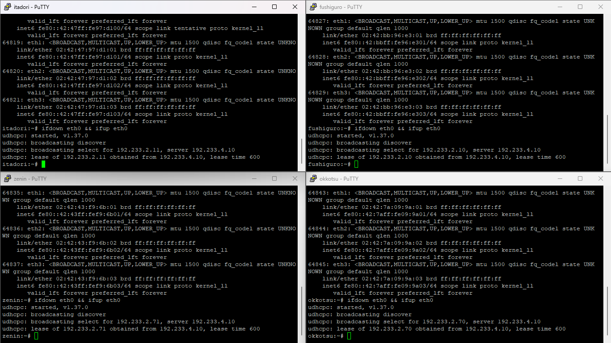

*Gambar 1: Verifikasi perolehan IP dinamis pada seluruh client Divisi A (`itadori`: `192.233.2.11`, `fushiguro`: `192.233.2.10`, `zenin`: `192.233.2.71`, `okkotsu`: `192.233.2.70`) yang sesuai dengan pembagian Pool 1 & Pool 2.*

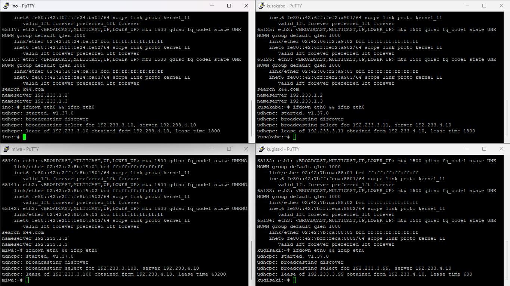

*Gambar 2: Verifikasi perolehan IP dinamis pada client Divisi B (`ino`: `192.233.3.10`, `kusakabe`: `192.233.3.11`, `miwa`: `192.233.3.100`, `kugisaki`: `192.233.3.99`) beserta durasi lease time masing-masing.*

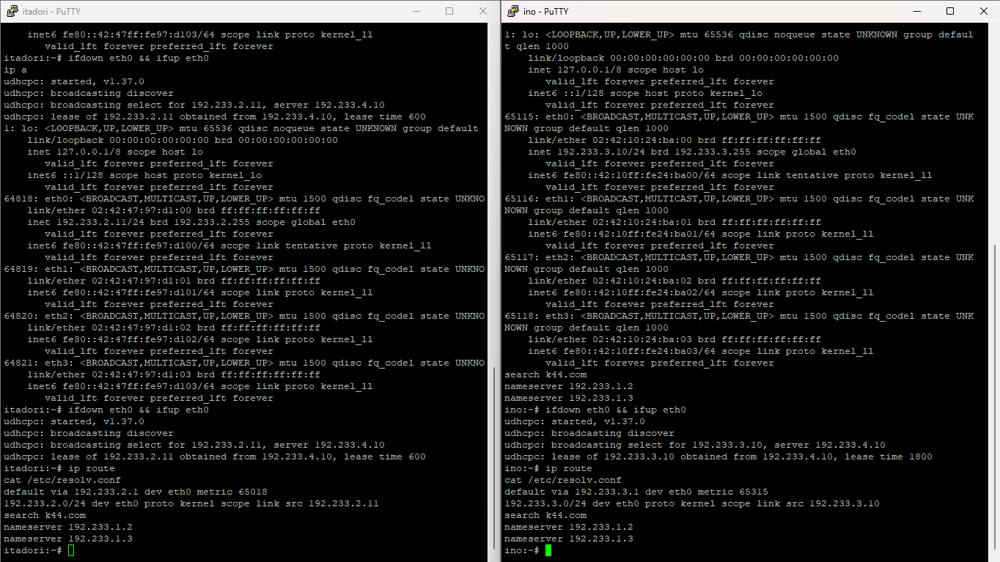

*Gambar 3: Verifikasi detail routing table (`ip route`) dan konfigurasi resolver (`cat /etc/resolv.conf`) pada client `itadori` dan `ino` yang memperlihatkan gateway dan DNS options global (`192.233.1.2`, `192.233.1.3`, domain `k44.com`).*

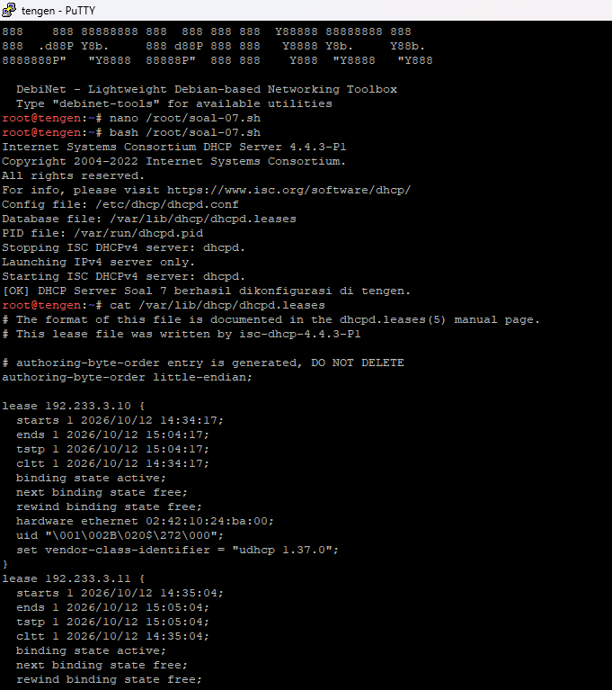

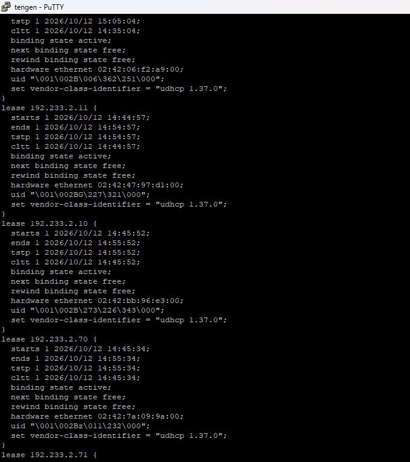

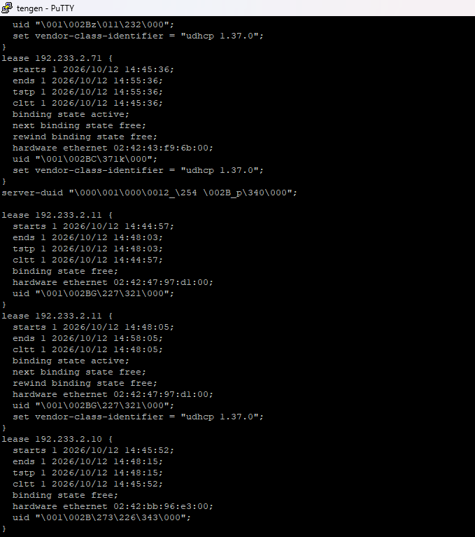

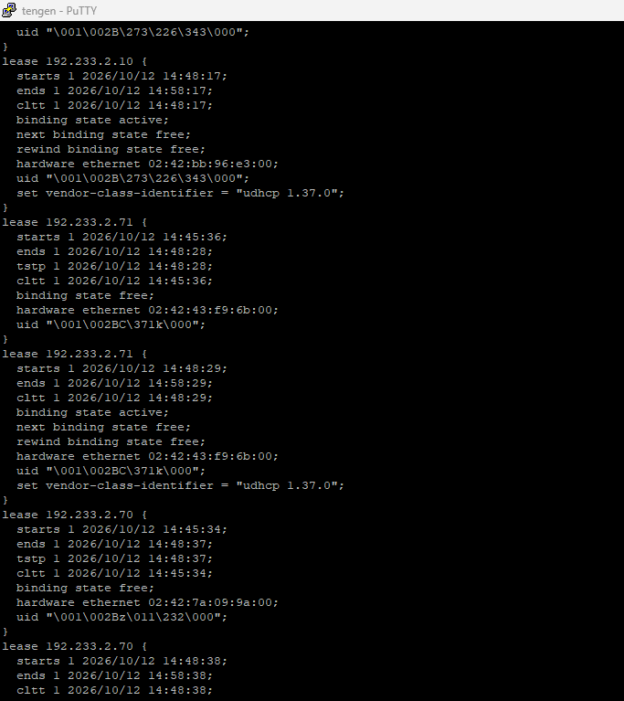

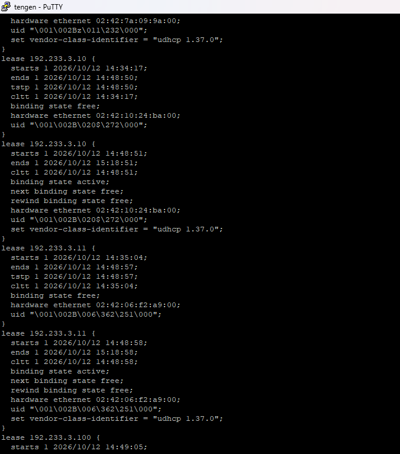

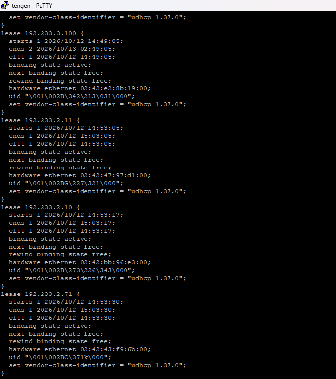

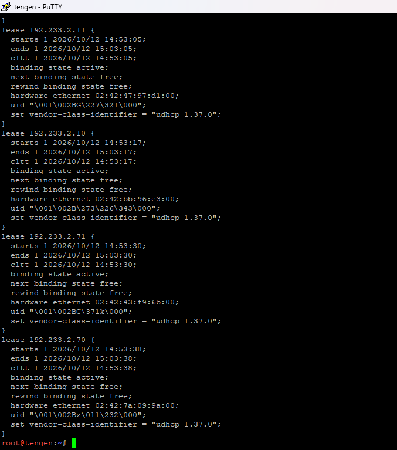

*Gambar 4 ~ 10: Verifikasi pangkalan data sewa `/var/lib/dhcp/dhcpd.leases` pada server `tengen` (rangkuman tampilan log 01 hingga 07) yang mencatat seluruh status sewa aktif (`binding state active`) untuk client Network 2 (`itadori`, `fushiguro`, `zenin`, `okkotsu`) dan Network 3 (`ino`, `kusakabe`, `miwa`, `kugisaki`) secara konsisten tanpa ada konflik IP.*

---

## Soal 8: Analisis Packet Capture Transaksi DHCP (DORA) dan Verifikasi Field Gateway IP (giaddr)

### Ringkasan Soal
Melakukan penangkapan paket (*packet capture*) transaksi DHCP pada node Data Center `tengen` (`192.233.4.10`) menggunakan utilitas `tcpdump` saat client Network 3 (`ino`) memperbarui sewa IP. Menganalisis alur empat tahap transaksi DHCP (DHCPDISCOVER, DHCPOFFER, DHCPREQUEST, DHCPACK) serta mengidentifikasi parameter utama dalam *header* paket, meliputi alamat DHCP server (`192.233.4.10`), alamat IP yang dialokasikan (`192.233.3.10`), durasi *lease time* (1800 detik), serta nilai *field* `giaddr` (Gateway IP). Memastikan nilai `giaddr` tercatat sebesar `192.233.3.1` sesuai dengan alamat interface `eth3` router `jichi` yang bertindak sebagai DHCP Relay Agent untuk Network 3.

---

### Apa Saja yang Harus Kita Lakukan?
1. Menjalankan perintah `tcpdump` dengan mode *verbose* pada interface `eth0` node `tengen` untuk memantau paket pada UDP port 67 dan port 68 (`udp port 67 or port 68`).
2. Memicu proses permohonan *lease* IP baru dari client Network 3 (`ino`) dengan mengeksekusi perintah `ifdown eth0 && ifup eth0`.
3. Menganalisis alur transmisi paket BOOTP/DHCP yang ditangkap oleh `tcpdump` pada node `tengen`.
4. Memeriksa detail opsi dan parameter paket DHCP ACK/Request pada terminal `tengen`:
    * **Server-ID (54)**: `192.233.4.10` (IP DHCP Server `tengen`)
    * **Your-IP / Requested-IP**: `192.233.3.10` (IP yang diberikan kepada `ino`)
    * **Lease-Time (51)**: `1800` detik (30 menit, sesuai kebijakan *short lease*)
    * **Gateway-IP (giaddr)**: `192.233.3.1` (IP interface `eth3` router `jichi`)
5. Memverifikasi bahwa nilai `giaddr` yang terbaca pada *packet capture* sudah sesuai dengan IP gateway subnet asal permintaan (`192.233.3.1`).

---

### Skrip Apa Saja yang Kita Gunakan?
**1. Perintah Packet Capture di Node DHCP Server (`tengen`)**
```bash
# Menangkap paket DHCP (UDP port 67 & 68) dengan detail verbose dan nomor MAC
tcpdump -i eth0 -nevv "udp port 67 or port 68"
```

**2. Perintah Renewal Lease di Node Client (`ino` / `itadori`)**
```bash
# Memicu ulang permohonan IP dinamis (DISCOVER -> OFFER -> REQUEST -> ACK)
ifdown eth0 && ifup eth0
```

---

### Mekanisme Pengujian
1. Buka terminal node **`tengen`**, lalu jalankan perintah `tcpdump -i eth0 -nevv "udp port 67 or port 68"`.
2. Buka terminal client **`ino`** (Network 3) atau **`itadori`** (Network 2), lalu eksekusi `ifdown eth0 && ifup eth0`.
3. Amati keluaran log `tcpdump` di terminal `tengen` untuk mengonfirmasi bahwa seluruh parameter (`Server-ID`, `Your-IP`, `Lease-Time`, dan `Gateway-IP / giaddr`) muncul dengan benar sesuai dengan spesifikasi protokol.

---

### Hasil

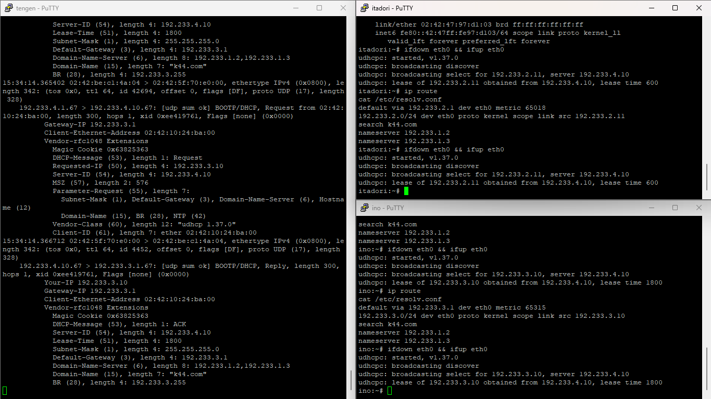

*Gambar 1: Hasil packet capture menggunakan tcpdump pada node `tengen` saat client `ino` melakukan renewal lease. Terlihat paket DHCP Request dan ACK dengan alamat server `192.233.4.10`, Your-IP `192.233.3.10`, Lease-Time 1800 detik, serta nilai Gateway-IP (giaddr) `192.233.3.1` yang berasal dari interface relay `jichi`.*

---

## Soal 9: Pengujian Disrupsi dan Pemulihan Layanan DHCP Relay pada Router Jichi

### Ringkasan Soal

Menguji ketahanan dan peran *DHCP Relay Agent* pada router `jichi` dengan mensimulasikan pemutusan jalur relay melalui penghentian *service* `isc-dhcp-relay`. Memaksa client Network 2 (`itadori`) meminta *lease* baru untuk mengamati gejala kegagalan perolehan IP akibat paket *broadcast DISCOVER* tidak diteruskan ke Data Center `tengen` (`192.233.4.10`). Selanjutnya, memulihkan kembali *service* `isc-dhcp-relay` di `jichi` dan membuktikan bahwa client kembali berhasil memperoleh alokasi IP yang benar dari *pool* (`192.233.2.11`) beserta *default gateway* semula (`192.233.2.1`).

---

### Apa Saja yang Harus Kita Lakukan?
1. Menghentikan *service* DHCP Relay pada router `jichi` menggunakan perintah `service isc-dhcp-relay stop` untuk mensimulasikan gangguan jaringan.
2. Memperbarui permintaan IP pada client Network 2 (`itadori`) menggunakan `ifdown eth0 && ifup eth0` dan mencatat respons kegagalan `udhcpc` (*failed to get a DHCP lease*).
3. Memulihkan *service* DHCP Relay pada router `jichi` menggunakan perintah `service isc-dhcp-relay start`.
4. Meminta ulang *lease* IP pada client `itadori` dengan perintah `ifdown eth0 && ifup eth0`.
5. Memeriksa kembali alamat IP, subnet, dan tabel *routing* pada client `itadori` menggunakan perintah `ip a` dan `ip route`.

---

### Skrip Apa Saja yang Kita Gunakan?
```bash
# 1. Di Router jichi: Menghentikan service DHCP Relay
service isc-dhcp-relay stop

# 2. Di Client (itadori): Meminta lease IP baru saat relay mati
ifdown eth0 && ifup eth0

# 3. Di Router jichi: Memulihkan kembali service DHCP Relay
service isc-dhcp-relay start

# 4. Di Client (itadori): Meminta ulang lease IP setelah relay aktif kembali
ifdown eth0 && ifup eth0
ip a
ip route
```

---

### Mekanisme Pengujian
1. Hentikan layanan relay di router **`jichi`** dengan menjalankan `service isc-dhcp-relay stop`.
2. Jalankan `ifdown eth0 && ifup eth0` di client **`itadori`** (Network 2) atau **`ino`** (Network 3), lalu amati proses `udhcpc` yang gagal mendapatkan alokasi alamat (*no lease*).
3. Jalankan `service isc-dhcp-relay start` di router **`jichi`** untuk memulihkan koneksi.
4. Ulangi perintah `ifdown eth0 && ifup eth0` di client **`itadori`**, kemudian eksekusi `ip a` serta `ip route` untuk memastikan alamat IP dan *default gateway* kembali diperoleh secara normal.

---

### Hasil

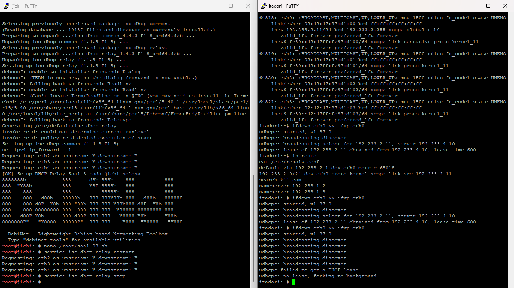

*Gambar 1: Hasil simulasi saat service isc-dhcp-relay di-stop pada router jichi. Client `itadori` terus-menerus mengirimkan paket broadcast DISCOVER dan berakhir dengan pesan error `udhcpc: failed to get a DHCP lease`.*

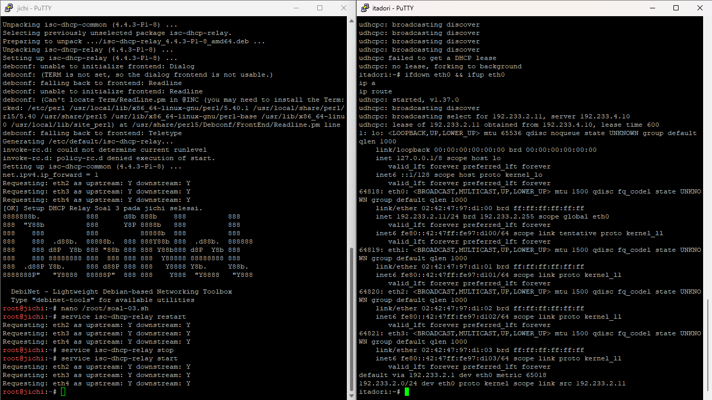

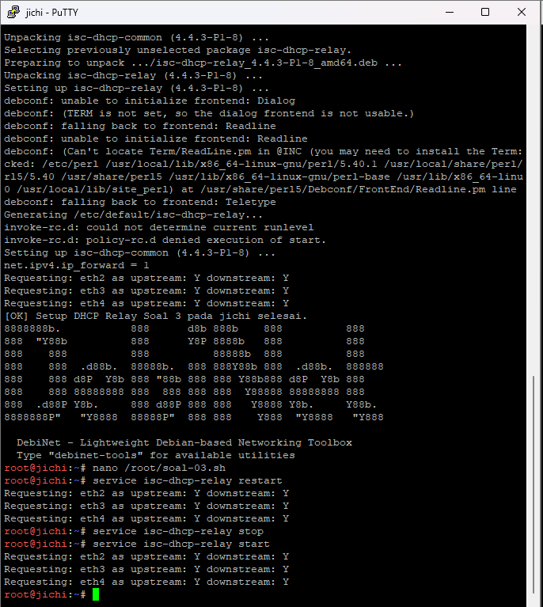

*Gambar 2: Hasil pengujian setelah service isc-dhcp-relay di-start kembali pada router jichi. Client `itadori` berhasil memperoleh kembali alokasi IP `192.233.2.11/24` dari DHCP Server `tengen` (`192.233.4.10`) dengan default gateway `192.233.2.1`.*

---

## Soal 10: Konfigurasi Persistensi Autostart Service DHCP Server dan DHCP Relay Pasca Reboot

### Ringkasan Soal
Mengonfigurasi mekanisme *autostart* dan persistensi layanan DHCP pada node Data Center `tengen` (`isc-dhcp-server`) dan router `jichi` (`isc-dhcp-relay`) agar seluruh konfigurasi layanan serta *IP forwarding* tetap aktif secara otomatis pasca-*reboot* tanpa memerlukan intervensi manual. Konfigurasi direalisasikan melalui eksekusi skrip otomatisasi `/root/soal-10.sh` yang dipanggil melalui arahan `up` pada berkas `/etc/network/interfaces` di masing-masing node. Pengujian dilakukan dengan memverifikasi status operasional layanan pasca-*reboot*, memeriksa perolehan alamat IP dinamis, durasi *lease*, dan *default gateway* pada client Network 2 (`itadori`) serta Network 3 (`ino`), serta membuktikan konektivitas jaringan dari client menuju server `tengen` (`192.233.4.10`).

---

### Apa Saja yang Harus Kita Lakukan?
1. Membuat skrip `/root/soal-10.sh` di router `jichi` untuk memastikan parameter kernel `net.ipv4.ip_forward=1` diaktifkan dan layanan `isc-dhcp-relay` dijalankan secara otomatis.
2. Memanggil skrip `/root/soal-10.sh` pada baris `up` di dalam file `/etc/network/interfaces` router `jichi`.
3. Membuat skrip `/root/soal-10.sh` di node `tengen` untuk menjalankan skrip konfigurasi kumulatif (`/root/soal-07.sh`) dan mere-restart layanan `isc-dhcp-server`.
4. Memanggil skrip `/root/soal-10.sh` pada baris `up` di dalam file `/etc/network/interfaces` node `tengen`.
5. Melakukan *reboot* pada node `jichi` dan `tengen` untuk menguji skenario penyiapan ulang otomatis.
6. Memeriksa status proses layanan pasca-*reboot* di `jichi` (`ps aux | grep dhcrelay`) dan status layanan di `tengen` (`service isc-dhcp-server status`).
7. Memperbarui permintaan *lease* IP (`ifdown eth0 && ifup eth0`), memeriksa entri tabel *routing* (`ip route`), serta menguji konektivitas (`ping -c 4 192.233.4.10`) dari client `itadori` dan `ino` menuju server `tengen`.

---

### Skrip Apa Saja yang Kita Gunakan?
**1. Skrip Persistensi DHCP Relay di Router `jichi` (`/root/soal-10.sh`)**
```bash
#!/bin/bash
# ========================================================
# Script Soal 10 - Autostart DHCP Relay (jichi)
# Kelompok: K44 | Prefix: 192.233
# ========================================================

# 1. Pastikan IP Forwarding aktif
sysctl -w net.ipv4.ip_forward=1

# 2. Restart & pastikan service berjalan
service isc-dhcp-relay restart

echo "[OK] Persistensi & Autostart DHCP Relay Soal 10 di jichi aktif."
```

**2. Konfigurasi `/etc/network/interfaces` di Node Router `jichi`**
```bash
auto eth0
iface eth0 inet dhcp
	up echo "nameserver 192.168.122.1" > /etc/resolv.conf

auto eth1
iface eth1 inet static
	address 192.233.1.1
	netmask 255.255.255.0

auto eth2
iface eth2 inet static
	address 192.233.2.1
	netmask 255.255.255.0

auto eth3
iface eth3 inet static
	address 192.233.3.1
	netmask 255.255.255.0

auto eth4
iface eth4 inet static
	address 192.233.4.1
	netmask 255.255.255.0

	up bash /root/soal-01.sh
	up bash /root/soal-03.sh
	up bash /root/soal-10.sh
```

**3. Skrip Persistensi DHCP Server di Node `tengen` (`/root/soal-10.sh`)**
```bash
#!/bin/bash
# ========================================================
# Script Soal 10 - Autostart DHCP Server (tengen)
# Kelompok: K44 | Prefix: 192.233
# ========================================================

# 1. Jalankan ulang konfigurasi kumulatif terakhir (Soal 7)
bash /root/soal-07.sh

# 2. Restart & pastikan service berjalan
service isc-dhcp-server restart

echo "[OK] Persistensi & Autostart DHCP Server Soal 10 di tengen aktif."
```

**4. Konfigurasi `/etc/network/interfaces` di Node `tengen`**
```bash
auto eth0
iface eth0 inet static
	address 192.233.4.10
	netmask 255.255.255.0
	gateway 192.233.4.1

	up echo "nameserver 192.168.122.1" > /etc/resolv.conf

	up bash /root/soal-02.sh
	up bash /root/soal-04.sh
	up bash /root/soal-05.sh
	up bash /root/soal-06.sh
	up bash /root/soal-07.sh
	up bash /root/soal-10.sh
```

---

### Mekanisme Pengujian
1. **Di Router `jichi` dan Node `tengen` Pasca Reboot**:
```bash
# Di jichi: Cek status proses dhcrelay
service isc-dhcp-relay status
ps aux | grep dhcrelay

# Di tengen: Cek status service isc-dhcp-server
service isc-dhcp-server status
```

2. **Di Client `itadori` (Network 2) dan `ino` (Network 3)**:
```bash
# Minta ulang alokasi IP dinamis
ifdown eth0 && ifup eth0

# Periksa alamat IP, netmask, dan default gateway
ip a
ip route

# Pengujian konektivitas ping ke DHCP Server tengen
ping -c 4 192.233.4.10
```

---

### Hasil

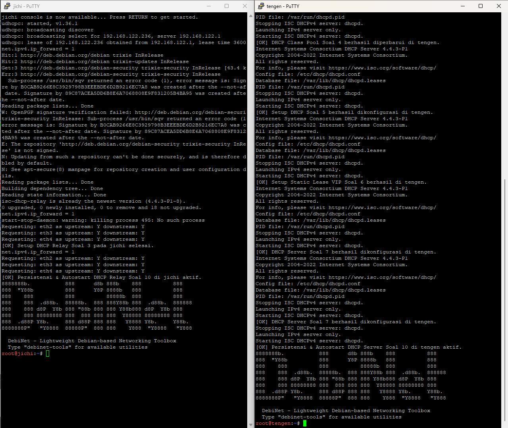

*Gambar 1: Output terminal saat interface dinyalakan pada node `jichi` dan `tengen` pasca reboot, menunjukkan eksekusi skrip `soal-10.sh` yang mengaktifkan kembali layanan DHCP Relay dan DHCP Server secara otomatis.*

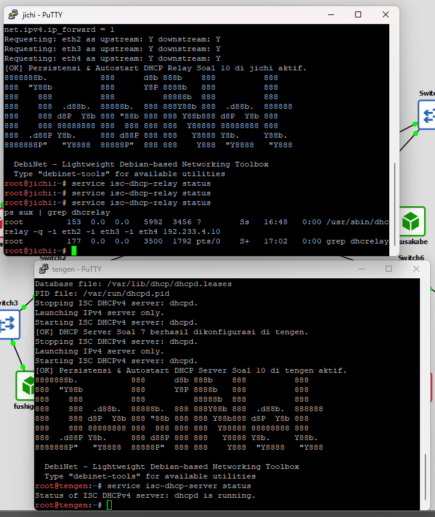

*Gambar 2: Verifikasi status layanan pasca reboot. Terlihat daemon `dhcrelay` berjalan aktif pada router `jichi` dan status `isc-dhcp-server` di node `tengen` menunjukkan status `dhcpd is running`.*

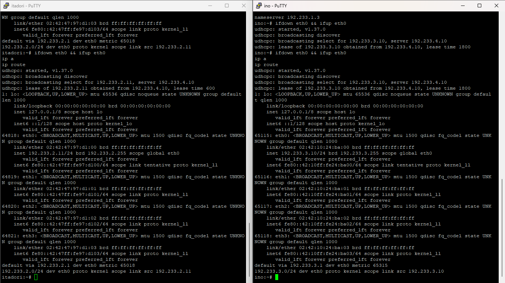

*Gambar 3: Hasil verifikasi perolehan IP dan routing pada client `itadori` (mendapatkan IP `192.233.2.11` dari Pool 1 Dev) dan client `ino` (mendapatkan IP `192.233.3.10` dengan short lease time 1800 detik) pasca reboot.*

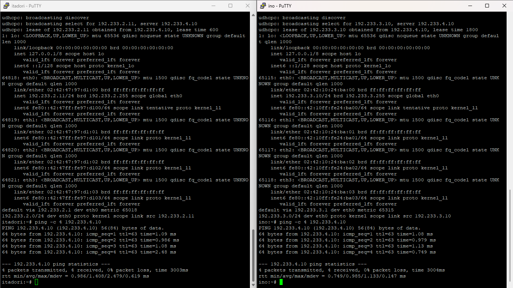

*Gambar 4: Pengujian konektivitas dari client `itadori` dan `ino` menuju DHCP Server `tengen` (`192.233.4.10`) pasca reboot yang sukses dengan 0% packet loss.*

---

## Soal 11: XXX

### Ringkasan Soal
xxx

---

### Apa Saja yang Harus Kita Lakukan?
1. xxx

---

### Skrip Apa Saja yang Kita Gunakan?
```bash

```

---

### Mekanisme Pengujian
```bash

```

---

### Hasil


---

## Soal 11

#Di Node utahime

cat > /root/soal-11.sh <<'SCRIPT'
#!/bin/sh
set -eu

### Nameserver untuk persiapan instalasi paket
printf 'nameserver 192.168.122.1\n' > /etc/resolv.conf

apt-get update
DEBIAN_FRONTEND=noninteractive apt-get install -y bind9 bind9-utils dnsutils

### Konfigurasi dasar DNS Master
cat > /etc/bind/named.conf.options <<'OPTIONS'
options {
    directory "/var/cache/bind";

    listen-on { any; };
    listen-on-v6 { any; };

    recursion no;
    allow-query { localhost; 192.233.0.0/16; };

    dnssec-validation auto;
};
OPTIONS

### Deklarasi zona utama
cat > /etc/bind/named.conf.local <<'LOCAL'
zone "jujutsu.k44.com" {
    type master;
    file "/etc/bind/db.jujutsu.k44.com";
    allow-transfer { 192.233.1.3; };
    also-notify { 192.233.1.3; };
};
LOCAL

### Isi zona DNS
cat > /etc/bind/db.jujutsu.k44.com <<'ZONE'
$TTL 86400
@ IN SOA utahime.jujutsu.k44.com. admin.jujutsu.k44.com. (
    2026101301
    3600
    900
    604800
    86400
)

@         IN NS  utahime.jujutsu.k44.com.
@         IN NS  shoko.jujutsu.k44.com.

utahime   IN A   192.233.1.2
shoko     IN A   192.233.1.3

sync-test IN TXT "dns-zone-sync-k44-v1"
ZONE

### Validasi sebelum menjalankan layanan
named-checkconf
named-checkzone jujutsu.k44.com /etc/bind/db.jujutsu.k44.com

### Terapkan konfigurasi
service bind9 restart

echo "Konfigurasi DNS Master selesai."
SCRIPT

chmod +x /root/soal-11.sh

### jalankan
bash /root/soal-11.sh
#cek layanan
service bind9 status
#uji dns master
dig @127.0.0.1 jujutsu.k44.com SOA


### DI shoko

cat > /etc/bind/named.conf.options <<'EOF'
options {
    directory "/var/cache/bind";
    listen-on { any; };
    listen-on-v6 { any; };
    recursion no;
    allow-query { localhost; 192.233.0.0/16; };
    dnssec-validation auto;
};
EOF

cat > /etc/bind/named.conf.local <<'EOF'
zone "jujutsu.k44.com" {
    type slave;
    masters { 192.233.1.2; };
    file "/var/cache/bind/db.jujutsu.k44.com";
};
EOF

named-checkconf
service named restart

### uji transfer zone
dig @127.0.0.1 jujutsu.k44.com SOA +short
dig @127.0.0.1 jujutsu.k44.com NS +short

#jalankan di utahime
sed -i \
  -e 's/2026101301/2026101302/' \
  -e 's/dns-zone-sync-k44-v1/dns-zone-sync-k44-v2/' \
  /etc/bind/db.jujutsu.k44.com

named-checkzone jujutsu.k44.com /etc/bind/db.jujutsu.k44.com
service named restart

### di shoko

dig @127.0.0.1 jujutsu.k44.com SOA +short
dig @127.0.0.1 sync-test.jujutsu.k44.com TXT +short

### verif dari client

dig @192.233.1.2 jujutsu.k44.com SOA +short
dig @192.233.1.3 jujutsu.k44.com SOA +short
dig @192.233.1.3 sync-test.jujutsu.k44.com TXT +short

---
 
## soal 12

#Di Node utahime


cat > /root/soal-12.sh <<'EOF'
#!/bin/sh
set -eu

DOMAIN="jujutsu.k44.com"
GOJO_IP="192.233.1.4"
GOJO_LAST="${GOJO_IP##*.}"
ZONE="/etc/bind/db.jujutsu.k44.com"
REV_ZONE="1.233.192.in-addr.arpa"
REV_FILE="/etc/bind/db.192.233.1"
BACKUP="/root/soal-12"

case "$GOJO_IP" in
    192.233.1.*) ;;
    *)
        echo "ERROR: IP Gojo harus berada di Network 1 (192.233.1.0/24)."
        exit 1
        ;;
esac

mkdir -p "$BACKUP"

# Cadangkan konfigurasi aktif sebelum perubahan.
for f in named.conf.options named.conf.local db.jujutsu.k44.com; do
    if [ -f "/etc/bind/$f" ]; then
        cp -a "/etc/bind/$f" "$BACKUP/$f"
    fi
done

if [ ! -f "$ZONE" ]; then
    echo "ERROR: File zona nomor 11 tidak ditemukan: $ZONE"
    exit 1
fi

# Ambil serial zona yang sekarang, kemudian naikkan satu.
OLD_SERIAL=$(awk '
    /SOA/ { inside=1; next }
    inside && /^[[:space:]]*[0-9][0-9][0-9][0-9][0-9][0-9][0-9][0-9][0-9][0-9][[:space:]]*$/ {
        gsub(/[[:space:]]/, "")
        print
        exit
    }
' "$ZONE")

if [ -z "$OLD_SERIAL" ]; then
    echo "ERROR: Nomor serial SOA tidak berhasil dibaca."
    exit 1
fi

NEXT_SERIAL=$((OLD_SERIAL + 1))

# Aktifkan recursive DNS melalui forwarder gateway.
cat > /etc/bind/named.conf.options <<'OPTIONS'
options {
    directory "/var/cache/bind";
    listen-on { any; };
    listen-on-v6 { any; };

    recursion yes;
    allow-query { localhost; 192.233.0.0/16; };
    allow-recursion { localhost; 192.233.0.0/16; };
    allow-query-cache { localhost; 192.233.0.0/16; };

    forwarders { 192.168.122.1; };
    forward only;

    dnssec-validation auto;
};
OPTIONS

# Zona utama dan zona Reverse DNS.
cat > /etc/bind/named.conf.local <<'LOCAL'
zone "jujutsu.k44.com" {
    type master;
    file "/etc/bind/db.jujutsu.k44.com";
    allow-transfer { 192.233.1.3; };
    also-notify { 192.233.1.3; };
};

zone "1.233.192.in-addr.arpa" {
    type master;
    file "/etc/bind/db.192.233.1";
    allow-transfer { 192.233.1.3; };
    also-notify { 192.233.1.3; };
};
LOCAL

# Zona forward: domain utama mengarah ke Gojo dan www menjadi CNAME.
cat > "$ZONE" <<ZONEFILE
\$TTL 86400
@ IN SOA utahime.jujutsu.k44.com. admin.jujutsu.k44.com. (
    $NEXT_SERIAL
    3600
    900
    604800
    86400
)

@       IN NS utahime.jujutsu.k44.com.
@       IN NS shoko.jujutsu.k44.com.
@       IN A  $GOJO_IP

www     IN CNAME jujutsu.k44.com.
utahime IN A 192.233.1.2
shoko   IN A 192.233.1.3
gojo    IN A $GOJO_IP

sync-test IN TXT "dns-zone-sync-k44-v2"
ZONEFILE

# Zona reverse /24: IP Gojo dapat ditelusuri ke domain utama.
cat > "$REV_FILE" <<REVFILE
\$TTL 86400
@ IN SOA utahime.jujutsu.k44.com. admin.jujutsu.k44.com. (
    $NEXT_SERIAL
    3600
    900
    604800
    86400
)

@ IN NS utahime.jujutsu.k44.com.
@ IN NS shoko.jujutsu.k44.com.
$GOJO_LAST IN PTR jujutsu.k44.com.
REVFILE

echo "=== Pemeriksaan konfigurasi ==="
named-checkconf
named-checkzone "$DOMAIN" "$ZONE"
named-checkzone "$REV_ZONE" "$REV_FILE"

echo "=== Restart DNS Master ==="
service named restart

echo "=== Hasil uji lokal Master ==="
dig @127.0.0.1 jujutsu.k44.com A +short
dig @127.0.0.1 www.jujutsu.k44.com CNAME +short
dig @127.0.0.1 -x "$GOJO_IP" +short

echo "=== Nomor serial baru: $NEXT_SERIAL ==="
echo "Backup konfigurasi lama: $BACKUP"
echo "Skrip tersimpan: /root/soal-12.sh"
EOF

chmod +x /root/soal-12.sh
/root/soal-12.sh

#verif
dig @127.0.0.1 jujutsu.k44.com A +short
dig @127.0.0.1 www.jujutsu.k44.com CNAME +short
dig @127.0.0.1 -x 192.233.1.4 +short

#Konfig slave, shoko

cat > /root/soal-12.sh <<'EOF'
#!/bin/sh
set -eu

BACKUP="/root/soal-12"
mkdir -p "$BACKUP"

# Cadangkan konfigurasi sebelumnya.
for f in named.conf.options named.conf.local; do
    if [ -f "/etc/bind/$f" ]; then
        cp -a "/etc/bind/$f" "$BACKUP/$f"
    fi
done

if [ -f /var/cache/bind/db.jujutsu.k44.com ]; then
    cp -a /var/cache/bind/db.jujutsu.k44.com \
        "$BACKUP/db.jujutsu.k44.com.before"
fi

# Forwarder untuk pencarian domain internet.
cat > /etc/bind/named.conf.options <<'OPTIONS'
options {
    directory "/var/cache/bind";
    listen-on { any; };
    listen-on-v6 { any; };

    recursion yes;
    allow-query { localhost; 192.233.0.0/16; };
    allow-recursion { localhost; 192.233.0.0/16; };
    allow-query-cache { localhost; 192.233.0.0/16; };

    forwarders { 192.168.122.1; };
    forward only;

    dnssec-validation auto;
};
OPTIONS

# Terima kedua zona dari DNS Master utahime.
cat > /etc/bind/named.conf.local <<'LOCAL'
zone "jujutsu.k44.com" {
    type slave;
    masters { 192.233.1.2; };
    file "/var/cache/bind/db.jujutsu.k44.com";
};

zone "1.233.192.in-addr.arpa" {
    type slave;
    masters { 192.233.1.2; };
    file "/var/cache/bind/db.1.233.192";
};
LOCAL

named-checkconf
service named restart

echo "Skrip tersimpan: /root/soal-12.sh"
echo "Backup konfigurasi: $BACKUP"
EOF

chmod +x /root/soal-12.sh
/root/soal-12.sh

#verif
dig @127.0.0.1 jujutsu.k44.com SOA +short
dig @127.0.0.1 jujutsu.k44.com A +short
dig @127.0.0.1 www.jujutsu.k44.com CNAME +short
dig @127.0.0.1 -x 192.233.1.4 +short

#uji dri client (itadori)

dig @192.233.1.2 jujutsu.k44.com A +short
dig @192.233.1.2 www.jujutsu.k44.com CNAME +short
dig @192.233.1.2 -x 192.233.1.4 +short

#uji dri dns slave (shoko)

dig @192.233.1.3 jujutsu.k44.com A +short
dig @192.233.1.3 www.jujutsu.k44.com CNAME +short
dig @192.233.1.3 -x 192.233.1.4 +short

#Di client (itadori) uji dns 

dig @192.233.1.2 google.com A +short
dig @192.233.1.3 google.com A +short

ping -c 4 google.com

---

## Soal 13

#Konfig master di yaga

cat > /root/soal-13.sh <<'EOF'
#!/bin/sh
set -eu

DB="db_shibuya_k44"
CONF="/etc/mysql/mariadb.conf.d/60-soal-13.cnf"
BACKUP="/root/soal-13"

# Pastikan yaga memiliki alamat pada Network 4.
MASTER_IP=$(ip -4 -o addr show scope global |
    awk '$4 ~ /^192\.233\.4\./ {
        a=$4
        sub(/\/.*/, "", a)
        print a
        exit
    }')

if [ -z "$MASTER_IP" ]; then
    echo "ERROR: IP yaga pada 192.233.4.0/24 tidak ditemukan."
    exit 1
fi

# Instal paket hanya jika MariaDB belum terpasang.
if ! command -v mariadbd >/dev/null 2>&1; then
    apt-get install -y mariadb-server mariadb-client
fi

mkdir -p "$BACKUP"

# Simpan konfigurasi lama jika ada.
if [ -f "$CONF" ] && [ ! -f "$BACKUP/60-soal-13.cnf.before" ]; then
    cp -a "$CONF" "$BACKUP/60-soal-13.cnf.before"
fi

# Simpan konfigurasi Master di /root.
cat > "$BACKUP/60-soal-13-master.cnf" <<'CNF'
[mariadb]
server-id=44
log-bin=mariadb-bin
binlog-format=ROW
bind-address=0.0.0.0
CNF

# Pasang konfigurasi aktif.
install -m 0644 "$BACKUP/60-soal-13-master.cnf" "$CONF"

echo "=== Restart MariaDB Master ==="
service mariadb restart

echo "=== Buat database dan tabel ==="
mariadb -uroot <<'SQL'
CREATE DATABASE IF NOT EXISTS db_shibuya_k44;

USE db_shibuya_k44;

CREATE TABLE IF NOT EXISTS request_logs (
    id BIGINT UNSIGNED NOT NULL AUTO_INCREMENT,
    created_at TIMESTAMP NOT NULL DEFAULT CURRENT_TIMESTAMP,
    method VARCHAR(10) DEFAULT NULL,
    path VARCHAR(255) DEFAULT NULL,
    client_ip VARCHAR(45) DEFAULT NULL,
    status_code SMALLINT UNSIGNED DEFAULT NULL,
    PRIMARY KEY (id)
) ENGINE=InnoDB;

CREATE USER IF NOT EXISTS
    'repl_k44'@'192.233.4.%'
    IDENTIFIED BY 'ReplK44_2026!';

GRANT REPLICATION SLAVE ON *.*
    TO 'repl_k44'@'192.233.4.%';

CREATE USER IF NOT EXISTS
    'app_k44'@'192.233.4.%'
    IDENTIFIED BY 'AppK44_2026!';

GRANT SELECT, INSERT, UPDATE, DELETE
    ON db_shibuya_k44.*
    TO 'app_k44'@'192.233.4.%';

FLUSH PRIVILEGES;
SQL

echo "=== Verifikasi binary logging ==="
mariadb -uroot -e \
    "SHOW VARIABLES WHERE Variable_name IN ('server_id','log_bin','binlog_format');"

echo "=== IP Master ==="
echo "$MASTER_IP"

echo "=== File dan posisi binary log Master ==="
mariadb -uroot -e "SHOW MASTER STATUS\G"

echo "Skrip: /root/soal-13.sh"
echo "Konfigurasi: $BACKUP/60-soal-13-master.cnf"
echo "Backup konfigurasi sebelumnya: $BACKUP"
EOF

chmod +x /root/soal-13.sh
/root/soal-13.sh

#Knfig slave di inumaki

cat > /root/soal-13.sh <<'EOF'
#!/bin/sh
set -eu

BACKUP="/root/soal-13"
CONF="/etc/mysql/mariadb.conf.d/60-soal-13.cnf"

# Minta alamat dan posisi binary log dari yaga.
printf "Masukkan IP Master yaga: "
IFS= read -r MASTER_IP

printf "Masukkan File dari SHOW MASTER STATUS: "
IFS= read -r MASTER_LOG_FILE

printf "Masukkan Position dari SHOW MASTER STATUS: "
IFS= read -r MASTER_LOG_POS

# Validasi agar tidak salah menghubungkan jaringan.
case "$MASTER_IP" in
    192.233.4.*) ;;
    *)
        echo "ERROR: IP Master harus berada di Network 4 (192.233.4.0/24)."
        exit 1
        ;;
esac

case "$MASTER_LOG_FILE" in
    mariadb-bin.*) ;;
    *)
        echo "ERROR: Periksa kembali nama File binary log dari yaga."
        exit 1
        ;;
esac

case "$MASTER_LOG_POS" in
    ''|*[!0-9]*)
        echo "ERROR: Position harus berupa angka."
        exit 1
        ;;
esac

if ! command -v mariadbd >/dev/null 2>&1; then
    apt-get install -y mariadb-server mariadb-client
fi

mkdir -p "$BACKUP"

if [ -f "$CONF" ] && [ ! -f "$BACKUP/60-soal-13.cnf.before" ]; then
    cp -a "$CONF" "$BACKUP/60-soal-13.cnf.before"
fi

# Simpan konfigurasi Slave di /root.
cat > "$BACKUP/60-soal-13-slave.cnf" <<'CNF'
[mariadb]
server-id=45
relay-log=mariadb-relay-bin
read-only=ON
bind-address=0.0.0.0
CNF

install -m 0644 "$BACKUP/60-soal-13-slave.cnf" "$CONF"

echo "=== Restart MariaDB Slave ==="
service mariadb restart

# Buat struktur awal yang sama dengan Master.
mariadb -uroot <<'SQL'
CREATE DATABASE IF NOT EXISTS db_shibuya_k44;

USE db_shibuya_k44;

CREATE TABLE IF NOT EXISTS request_logs (
    id BIGINT UNSIGNED NOT NULL AUTO_INCREMENT,
    created_at TIMESTAMP NOT NULL DEFAULT CURRENT_TIMESTAMP,
    method VARCHAR(10) DEFAULT NULL,
    path VARCHAR(255) DEFAULT NULL,
    client_ip VARCHAR(45) DEFAULT NULL,
    status_code SMALLINT UNSIGNED DEFAULT NULL,
    PRIMARY KEY (id)
) ENGINE=InnoDB;

CREATE USER IF NOT EXISTS
    'app_k44'@'192.233.4.%'
    IDENTIFIED BY 'AppK44_2026!';

GRANT SELECT, INSERT, UPDATE, DELETE
    ON db_shibuya_k44.*
    TO 'app_k44'@'192.233.4.%';

FLUSH PRIVILEGES;
SQL

# Hubungkan Slave ke Master menggunakan file dan posisi yang dicatat.
mariadb -uroot <<SQL
STOP SLAVE;
RESET SLAVE ALL;

CHANGE MASTER TO
    MASTER_HOST='$MASTER_IP',
    MASTER_PORT=3306,
    MASTER_USER='repl_k44',
    MASTER_PASSWORD='ReplK44_2026!',
    MASTER_LOG_FILE='$MASTER_LOG_FILE',
    MASTER_LOG_POS=$MASTER_LOG_POS,
    MASTER_CONNECT_RETRY=5;

START SLAVE;
SQL

echo "=== Status replikasi Slave ==="
mariadb -uroot -e "SHOW SLAVE STATUS\G"

echo "Skrip: /root/soal-13.sh"
echo "Konfigurasi: $BACKUP/60-soal-13-slave.cnf"
echo "Backup konfigurasi sebelumnya: $BACKUP"
EOF

chmod +x /root/soal-13.sh
/root/soal-13.sh

#di yaga

mariadb -uroot

INSERT INTO db_shibuya_k44.request_logs
    (method, path, client_ip, status_code)
VALUES
    ('TEST', '/soal-13-replikasi', '192.233.4.250', 200);

SELECT *
FROM db_shibuya_k44.request_logs
WHERE path = '/soal-13-replikasi';

exit;

#cek data di slave inumaki

mariadb -uroot -e "
SELECT *
FROM db_shibuya_k44.request_logs
WHERE path = '/soal-13-replikasi';
"

#network 4, di inumaki

mariadb --protocol=TCP -h 192.233.4.8 -u app_k44 -p

pass : AppK44_2026!

#jalanin

SELECT COUNT(*) FROM db_shibuya_k44.request_logs;
exit;

---

## Soal 14

#Di Node yaga

mariadb -u root

SHOW DATABASES LIKE 'db_shibuya_k44';

USE db_shibuya_k44;

DESCRIBE request_logs;

SELECT User, Host
FROM mysql.user
WHERE User = 'app_k44';

#jalanin

CREATE USER IF NOT EXISTS 'apiuser'@'192.233.4.%'
IDENTIFIED BY 'ApiLab2026Change';

ALTER USER 'apiuser'@'192.233.4.%'
IDENTIFIED BY 'ApiLab2026Change';

GRANT SELECT, INSERT, UPDATE, DELETE
ON db_shibuya_k44.*
TO 'apiuser'@'192.233.4.%';

FLUSH PRIVILEGES;

EXIT;

#di maki & panda buat =

cat > /root/q14_frontend.sh <<'SCRIPT'
#!/bin/bash
set -Eeuo pipefail

GROUP="k44"
DOMAIN="jujutsu.${GROUP}.com"

read -rp "Nama worker (maki/panda): " WORKER_NAME
read -rp "IP Gojo pada Network 1: " GOJO_IP

if [[ "$WORKER_NAME" != "maki" && "$WORKER_NAME" != "panda" ]]; then
    echo "ERROR: Nama worker harus maki atau panda."
    exit 1
fi

if [[ ! "$GOJO_IP" =~ ^([0-9]{1,3}\.){3}[0-9]{1,3}$ ]]; then
    echo "ERROR: Format IP Gojo tidak valid."
    exit 1
fi

echo "=== Instalasi frontend ==="
apt-get update
DEBIAN_FRONTEND=noninteractive apt-get install -y \
    nginx php-fpm php-mysql

# Set hostname agar hasil halaman sesuai nama node.
printf '%s\n' "$WORKER_NAME" > /etc/hostname
hostname "$WORKER_NAME"

# Temukan service PHP-FPM yang terpasang.
FPM_INIT="$(find /etc/init.d -maxdepth 1 \
    -type f -name 'php*-fpm' -print -quit)"

if [ -n "$FPM_INIT" ]; then
    service "$(basename "$FPM_INIT")" restart
fi

PHP_SOCKET="$(find /run/php -maxdepth 1 \
    -type s -name 'php*-fpm.sock' -print -quit)"

if [ -z "$PHP_SOCKET" ]; then
    echo "ERROR: Socket PHP-FPM tidak ditemukan."
    ls -la /run/php/ || true
    exit 1
fi

mkdir -p /root/backup-q14 /var/www/html

# Backup default site jika belum pernah disimpan.
if [ -f /etc/nginx/sites-available/default ] &&
   [ ! -f /root/backup-q14/nginx-default.before ]; then
    cp -a /etc/nginx/sites-available/default \
        /root/backup-q14/nginx-default.before
fi

# Halaman frontend yang menampilkan hostname.
cat > /var/www/html/index.php <<'PHP'
<?php
header('Content-Type: text/plain; charset=utf-8');
echo "Frontend worker: " . gethostname() . PHP_EOL;
PHP

# Virtual host frontend.
cat > /etc/nginx/sites-available/q14-frontend <<NGINX
server {
    listen 80 default_server;
    server_name ${DOMAIN} www.${DOMAIN};

    root /var/www/html;
    index index.php index.html;

    # Hanya Gojo yang boleh mengakses frontend worker.
    allow ${GOJO_IP};
    deny all;

    location / {
        try_files \$uri \$uri/ /index.php?\$query_string;
    }

    location ~ \.php\$ {
        try_files \$uri =404;
        include fastcgi_params;
        fastcgi_param SCRIPT_FILENAME \$document_root\$fastcgi_script_name;
        fastcgi_pass unix:${PHP_SOCKET};
    }
}
NGINX

rm -f /etc/nginx/sites-enabled/default
ln -sfn /etc/nginx/sites-available/q14-frontend \
    /etc/nginx/sites-enabled/q14-frontend

chown -R www-data:www-data /var/www/html

echo "=== Validasi dan restart Nginx ==="
php -l /var/www/html/index.php
nginx -t
service nginx restart
service nginx status

echo "Frontend ${WORKER_NAME} selesai dikonfigurasi."
SCRIPT

bash /root/q14_frontend.sh

# uji di node gojo

curl -i -H "Host: jujutsu.k44.com" http://IP_MAKI/
curl -i -H "Host: www.jujutsu.k44.com" http://IP_PANDA/

# buat script di nanami , todo, kirara 

cat > /root/q14_api_worker.sh <<'SCRIPT'
#!/bin/bash
set -Eeuo pipefail

GROUP="k44"
DOMAIN="jujutsu.${GROUP}.com"
DB_NAME="db_shibuya_${GROUP}"
DB_USER="apiuser"

read -rp "Nama worker (nanami/todo/kirara): " WORKER_NAME
read -rp "IP Geto pada Network 4: " GETO_IP
read -rp "IP Yaga pada Network 4: " YAGA_IP
read -rsp "Password apiuser pada Yaga: " DB_PASSWORD
echo

case "$WORKER_NAME" in
    nanami|todo|kirara) ;;
    *)
        echo "ERROR: Nama worker harus nanami, todo, atau kirara."
        exit 1
        ;;
esac

for IP_VALUE in "$GETO_IP" "$YAGA_IP"; do
    if [[ ! "$IP_VALUE" =~ ^([0-9]{1,3}\.){3}[0-9]{1,3}$ ]]; then
        echo "ERROR: Format IP tidak valid: $IP_VALUE"
        exit 1
    fi
done

# Gunakan password yang sama dengan akun di Yaga.
# Base64 menghindari masalah kutip saat menulis konfigurasi PHP.
DB_PASSWORD_B64="$(printf '%s' "$DB_PASSWORD" | base64 | tr -d '\n')"
unset DB_PASSWORD

echo "=== Instalasi API worker ==="
apt-get update
DEBIAN_FRONTEND=noninteractive apt-get install -y \
    nginx php-fpm php-mysql

# Set hostname agar log menunjukkan worker yang benar.
printf '%s\n' "$WORKER_NAME" > /etc/hostname
hostname "$WORKER_NAME"

FPM_INIT="$(find /etc/init.d -maxdepth 1 \
    -type f -name 'php*-fpm' -print -quit)"

if [ -n "$FPM_INIT" ]; then
    service "$(basename "$FPM_INIT")" restart
fi

PHP_SOCKET="$(find /run/php -maxdepth 1 \
    -type s -name 'php*-fpm.sock' -print -quit)"

if [ -z "$PHP_SOCKET" ]; then
    echo "ERROR: Socket PHP-FPM tidak ditemukan."
    ls -la /run/php/ || true
    exit 1
fi

mkdir -p /root/backup-q14 /var/www/api

if [ -f /etc/nginx/sites-available/default ] &&
   [ ! -f /root/backup-q14/nginx-default.before ]; then
    cp -a /etc/nginx/sites-available/default \
        /root/backup-q14/nginx-default.before
fi

# Konfigurasi koneksi database.
cat > /var/www/api/config.php <<PHP_CONFIG
<?php
return [
    'host' => '${YAGA_IP}',
    'database' => '${DB_NAME}',
    'username' => '${DB_USER}',
    'password' => base64_decode('${DB_PASSWORD_B64}'),
];
PHP_CONFIG

unset DB_PASSWORD_B64

# Endpoint API yang mencatat request ke database.
cat > /var/www/api/index.php <<'PHP'
<?php

header('Content-Type: application/json; charset=utf-8');

$method = $_SERVER['REQUEST_METHOD'] ?? 'GET';
$path = parse_url(
    $_SERVER['REQUEST_URI'] ?? '/',
    PHP_URL_PATH
) ?: '/';

$worker = gethostname();
$clientIp = $_SERVER['REMOTE_ADDR'] ?? 'unknown';
$statusCode = 200;

try {
    mysqli_report(MYSQLI_REPORT_ERROR | MYSQLI_REPORT_STRICT);

    $cfg = require __DIR__ . '/config.php';

    $db = new mysqli(
        $cfg['host'],
        $cfg['username'],
        $cfg['password'],
        $cfg['database']
    );

    $db->set_charset('utf8mb4');

    $stmt = $db->prepare(
        'INSERT INTO request_logs
         (method, path, client_ip, worker, status_code)
         VALUES (?, ?, ?, ?, ?)'
    );

    $stmt->bind_param(
        'ssssi',
        $method,
        $path,
        $clientIp,
        $worker,
        $statusCode
    );

    $stmt->execute();
    $stmt->close();
    $db->close();

    echo json_encode([
        'status' => 'ok',
        'worker' => $worker,
        'path' => $path,
        'client_ip' => $clientIp
    ], JSON_UNESCAPED_SLASHES), PHP_EOL;

} catch (Throwable $e) {
    error_log($e->getMessage());
    http_response_code(500);

    echo json_encode([
        'status' => 'error',
        'message' => 'Database logging failed'
    ], JSON_UNESCAPED_SLASHES), PHP_EOL;
}
PHP

# Virtual host API.
cat > /etc/nginx/sites-available/q14-api <<NGINX
server {
    listen 80 default_server;
    server_name ${DOMAIN} www.${DOMAIN} api.${DOMAIN};

    root /var/www/api;
    index index.php;

    # Hanya Geto yang boleh mengakses API worker.
    allow ${GETO_IP};
    deny all;

    location / {
        try_files \$uri \$uri/ /index.php?\$query_string;
    }

    location ~ \.php\$ {
        try_files \$uri =404;
        include fastcgi_params;
        fastcgi_param SCRIPT_FILENAME \$document_root\$fastcgi_script_name;
        fastcgi_pass unix:${PHP_SOCKET};
    }
}
NGINX

rm -f /etc/nginx/sites-enabled/default
ln -sfn /etc/nginx/sites-available/q14-api \
    /etc/nginx/sites-enabled/q14-api

chown -R www-data:www-data /var/www/api
chmod 640 /var/www/api/config.php

echo "=== Validasi konfigurasi ==="
php -l /var/www/api/config.php
php -l /var/www/api/index.php
php -m | grep -i mysqli
nginx -t

service nginx restart
service nginx status

echo "API worker ${WORKER_NAME} selesai dikonfigurasi."
SCRIPT

bash /root/q14_api_worker.sh

# uji hasil API di geto

curl -i -H "Host: jujutsu.k44.com" http://IP_NANAMI/api
curl -i -H "Host: jujutsu.k44.com" http://IP_TODO/api
curl -i -H "Host: jujutsu.k44.com" http://IP_KIRARA/api

# dari salah satu klien di network 2 / 3

curl -i http://IP_MAKI/
curl -i http://IP_PANDA/

curl -i http://IP_NANAMI/api
curl -i http://IP_TODO/api
curl -i http://IP_KIRARA/api

---

## SOAL 15

# Di node nanami & todo

cat << 'EOF' > /var/www/html/index.php
<?php
header('Content-Type: application/json');
echo json_encode([
    "worker" => "nanami" // ganti sesuai nama node (nanami, todo)
    "hostname" => gethostname(),
    "status" => "API Active"
]) . "\n";
?>
EOF

#jalankkan

cat << 'EOF' > /etc/nginx/sites-available/default
server {
    listen 80 default_server;
    listen [::]:80 default_server;

    root /var/www/html;
    index index.php index.html index.htm;

    server_name _;

    # Pembatasan akses (Hanya localhost dan Geto yang diizinkan)
    allow 127.0.0.1;
    allow 192.233.4.2;
    deny all;

    location / {
        try_files $uri $uri/ =404;
    }

    location ~ \.php$ {
        include snippets/fastcgi-php.conf;
        fastcgi_pass unix:/var/run/php/php8.4-fpm.sock;
    }
}
EOF

# uji

nginx -t && service nginx restart
curl -i http://localhost/

# Di geto 

apt-get update
apt-get install -y nginx curl

rm -f /etc/nginx/sites-enabled/default

# konfig

cat << 'EOF' > /etc/nginx/sites-available/api_cluster
upstream api_cluster {
    # nanami menerima beban 3x lebih banyak dibanding todo
    server 192.233.4.5:80 weight=3;
    server 192.233.4.6:80 weight=1;
}

server {
    listen 80;
    server_name _;

    location / {
        proxy_pass http://api_cluster;
        proxy_set_header Host $host;
        proxy_set_header X-Real-IP $remote_addr;
        proxy_set_header X-Forwarded-For $proxy_add_x_forwarded_for;
        proxy_set_header X-Forwarded-Proto $scheme;

        # Timeout koneksi agar responsif
        proxy_connect_timeout 5s;
        proxy_read_timeout 10s;
    }
}
EOF

# aktifkan

ln -sf /etc/nginx/sites-available/api_cluster /etc/nginx/sites-enabled/
nginx -t
service nginx restart

# tes di inumaki

for i in {1..20}; do
    curl -s http://192.233.4.2/
done

# tes 2

for i in {1..40}; do
    curl -s http://192.233.4.2/ | grep -o '"worker":"[^"]*"'
done | sort | uniq -c

--- 

## SOAL 16

# Di Maki

echo "nameserver 192.168.122.1" > /etc/resolv.conf
mkdir -p /var/www/html
apt-get update && apt-get install -y nginx curl

# Buat halaman frontend Maki
cat << 'EOF' > /var/www/html/index.html
Frontend Response: MAKI (Worker Frontend 1)
EOF

# Izinkan localhost dan Gojo (192.233.1.4), tolak akses langsung lainnya
cat << 'EOF' > /etc/nginx/sites-available/default
server {
    listen 80 default_server;
    listen [::]:80 default_server;
    root /var/www/html;
    index index.html index.htm;
    server_name _;

    allow 127.0.0.1;
    allow ::1;
    allow 192.233.1.4; # Ganti dengan IP Gojo Anda
    deny all;

    location / {
        try_files $uri $uri/ =404;
    }
}
EOF

nginx -t && service nginx restart

# di panda

echo "nameserver 192.168.122.1" > /etc/resolv.conf
mkdir -p /var/www/html
apt-get update && apt-get install -y nginx curl

# Buat halaman frontend Panda
cat << 'EOF' > /var/www/html/index.html
Frontend Response: PANDA (Worker Frontend 2)
EOF

# Izinkan localhost dan Gojo (192.233.1.4), tolak akses langsung lainnya
cat << 'EOF' > /etc/nginx/sites-available/default
server {
    listen 80 default_server;
    listen [::]:80 default_server;
    root /var/www/html;
    index index.html index.htm;
    server_name _;

    allow 127.0.0.1;
    allow ::1;
    allow 192.233.1.4; # Ganti dengan IP Gojo Anda
    deny all;

    location / {
        try_files $uri $uri/ =404;
    }
}
EOF

nginx -t && service nginx restart

# di gojo 

echo "nameserver 192.168.122.1" > /etc/resolv.conf
apt-get update
apt-get install -y nginx curl

rm -f /etc/nginx/sites-enabled/default

# konfig

cat << 'EOF' > /etc/nginx/sites-available/jujutsu
# Upstream Frontend: Round Robin maki & panda
upstream frontend_cluster {
    server 192.233.4.3:80; # IP maki
    server 192.233.4.4:80; # IP panda
}

# Upstream API: Load Balancer Geto
upstream api_backend {
    server 192.233.4.2:80; # IP geto
}

server {
    listen 80;
    server_name jujutsu.k44.com www.jujutsu.k44.com;

    # 1. Routing Root (/) ke Worker Frontend (Round Robin Maki/Panda)
    location / {
        proxy_pass http://frontend_cluster;
        proxy_set_header Host $host;
        proxy_set_header X-Real-IP $remote_addr;
        proxy_set_header X-Forwarded-For $proxy_add_x_forwarded_for;
        proxy_set_header X-Forwarded-Proto $scheme;
    }

    # 2. Routing Path /api ke Internal Load Balancer Geto
    location /api {
        rewrite ^/api/?(.*)$ /$1 break;
        proxy_pass http://api_backend;
        proxy_set_header Host $host;
        proxy_set_header X-Real-IP $remote_addr;
        proxy_set_header X-Forwarded-For $proxy_add_x_forwarded_for;
        proxy_set_header X-Forwarded-Proto $scheme;
    }
}
EOF

# aktifkan

ln -sf /etc/nginx/sites-available/jujutsu /etc/nginx/sites-enabled/
nginx -t
service nginx restart

# pengujian dri ino

for i in {1..6}; do
    curl -s http://jujutsu.k44.com/
done


for i in {1..8}; do
    curl -s http://jujutsu.k44.com/api
done

---

# masuk ke consol mariaDB di yaga

mariadb -u root -p

USE db_shibuya_k44;

-- Buat tabel request_logs jika belum ada
CREATE TABLE IF NOT EXISTS request_logs (
    id INT AUTO_INCREMENT PRIMARY KEY,
    client_ip VARCHAR(45) NOT NULL,
    worker VARCHAR(50),
    endpoint VARCHAR(255),
    created_at TIMESTAMP DEFAULT CURRENT_TIMESTAMP
);

-- Pastikan user app_k44 memiliki izin akses dari seluruh Network 4
GRANT ALL PRIVILEGES ON db_shibuya_k44.* TO 'app_k44'@'192.233.4.%' IDENTIFIED BY 'AppK44_2026!';
FLUSH PRIVILEGES;
EXIT;

# di gojo 

cat << 'EOF' > /etc/nginx/sites-available/jujutsu
upstream frontend_cluster {
    server 192.233.4.3:80;
    server 192.233.4.4:80;
}

upstream api_backend {
    server 192.233.4.2:80;
}

server {
    listen 80;
    server_name jujutsu.k44.com www.jujutsu.k44.com;

    location / {
        proxy_pass http://frontend_cluster;
        proxy_set_header Host $host;
        proxy_set_header X-Real-IP $remote_addr;
        proxy_set_header X-Forwarded-For $proxy_add_x_forwarded_for;
        proxy_set_header X-Forwarded-Proto $scheme;
    }

    location /api {
        rewrite ^/api/?(.*)$ /$1 break;
        proxy_pass http://api_backend;
        proxy_set_header Host $host;
        proxy_set_header X-Real-IP $remote_addr;
        proxy_set_header X-Forwarded-For $proxy_add_x_forwarded_for;
        proxy_set_header X-Forwarded-Proto $scheme;
    }
}
EOF

nginx -t && service nginx reload

# di geto

cat << 'EOF' > /etc/nginx/sites-available/api_cluster
upstream api_cluster {
    server 192.233.4.5:80 weight=3;
    server 192.233.4.6:80 weight=1;
}

server {
    listen 80 default_server;
    server_name _;

    # Hanya percaya header IP dari IP node Gojo (192.233.1.4)
    set_real_ip_from 192.233.1.4;
    set_real_ip_from 192.233.1.0/24;
    real_ip_header X-Forwarded-For;
    real_ip_recursive on;

    location / {
        proxy_pass http://api_cluster;
        proxy_set_header Host $host;
        # Meneruskan IP asli yang sudah divalidasi ke worker backend
        proxy_set_header X-Real-IP $remote_addr;
        proxy_set_header X-Forwarded-For $proxy_add_x_forwarded_for;
        proxy_set_header X-Forwarded-Proto $scheme;
    }
}
EOF

nginx -t && service nginx restart

# di node nanami & todo

cat << 'EOF' > /var/www/html/index.php
<?php
header('Content-Type: application/json');

// Mengambil IP asli dari header yang diteruskan proxy
$client_ip = $_SERVER['REMOTE_ADDR'];
if (!empty($_SERVER['HTTP_X_REAL_IP'])) {
    $client_ip = $_SERVER['HTTP_X_REAL_IP'];
} elseif (!empty($_SERVER['HTTP_X_FORWARDED_FOR'])) {
    $ips = explode(',', $_SERVER['HTTP_X_FORWARDED_FOR']);
    $client_ip = trim($ips[0]);
}

$worker_name = "nanami";
$db_host = "192.233.4.11"; // Ganti jika IP yaga berbeda
$db_user = "app_k44";
$db_pass = "AppK44_2026!";
$db_name = "db_shibuya_k44";

$db_status = "unrecorded";

try {
    $pdo = new PDO("mysql:host=$db_host;dbname=$db_name;charset=utf8", $db_user, $db_pass, [
        PDO::ATTR_ERRMODE => PDO::ERRMODE_EXCEPTION,
        PDO::ATTR_TIMEOUT => 3
    ]);

    $stmt = $pdo->prepare("INSERT INTO request_logs (client_ip, worker, endpoint) VALUES (:ip, :worker, :endpoint)");
    $stmt->execute([
        ':ip' => $client_ip,
        ':worker' => $worker_name,
        ':endpoint' => $_SERVER['REQUEST_URI']
    ]);
    $db_status = "logged_successfully";
} catch (Exception $e) {
    $db_status = "error: " . $e->getMessage();
}

echo json_encode([
    "worker" => $worker_name,
    "hostname" => gethostname(),
    "recorded_client_ip" => $client_ip,
    "database_logging" => $db_status
], JSON_PRETTY_PRINT) . "\n";
?>
EOF

chmod 644 /var/www/html/index.php
/etc/init.d/php8.4-fpm restart
chmod 777 /var/run/php/php8.4-fpm.sock

# validasi di itadori & ino

ip -4 a show eth0
curl -s http://jujutsu.k44.com/api

# cek di yaga

mariadb -u app_k44 -p'AppK44_2026!' -e "USE db_shibuya_k44; SELECT id, client_ip, worker, endpoint, created_at FROM request_logs ORDER BY id DESC LIMIT 10;"

---

## Soal 18

# DI kirara

echo "nameserver 192.168.122.1" > /etc/resolv.conf
rm -f /etc/apt/sources.list.d/*.sources 2>/dev/null

cat << 'EOF' > /etc/apt/sources.list
deb [trusted=yes] http://deb.debian.org/debian trixie main
deb [trusted=yes] http://deb.debian.org/debian trixie-updates main
EOF
echo 'Acquire::Check-Valid-Until "false";' > /etc/apt/apt.conf.d/99no-check-valid-until

apt-get update
apt-get install -y nginx php-fpm php-mysql curl

# buat skrip API

mkdir -p /var/www/html

cat << 'EOF' > /var/www/html/index.php
<?php
header('Content-Type: application/json');

$client_ip = $_SERVER['REMOTE_ADDR'];
if (!empty($_SERVER['HTTP_X_REAL_IP'])) {
    $client_ip = $_SERVER['HTTP_X_REAL_IP'];
} elseif (!empty($_SERVER['HTTP_X_FORWARDED_FOR'])) {
    $ips = explode(',', $_SERVER['HTTP_X_FORWARDED_FOR']);
    $client_ip = trim($ips[0]);
}

$worker_name = "kirara";
$db_host = "192.233.4.11"; // Ganti jika IP yaga berbeda
$db_user = "app_k44";
$db_pass = "AppK44_2026!";
$db_name = "db_shibuya_k44";

$db_status = "unrecorded";

try {
    $pdo = new PDO("mysql:host=$db_host;dbname=$db_name;charset=utf8", $db_user, $db_pass, [
        PDO::ATTR_ERRMODE => PDO::ERRMODE_EXCEPTION,
        PDO::ATTR_TIMEOUT => 3
    ]);

    $stmt = $pdo->prepare("INSERT INTO request_logs (client_ip, worker, endpoint) VALUES (:ip, :worker, :endpoint)");
    $stmt->execute([
        ':ip' => $client_ip,
        ':worker' => $worker_name,
        ':endpoint' => $_SERVER['REQUEST_URI']
    ]);
    $db_status = "logged_successfully";
} catch (Exception $e) {
    $db_status = "error: " . $e->getMessage();
}

echo json_encode([
    "worker" => $worker_name,
    "hostname" => gethostname(),
    "recorded_client_ip" => $client_ip,
    "database_logging" => $db_status
], JSON_PRETTY_PRINT) . "\n";
?>
EOF

chmod 644 /var/www/html/index.php

# konfig nginx virtual host

/etc/init.d/php*-fpm restart
SOCK=$(ls /var/run/php/php*-fpm.sock 2>/dev/null | head -n 1)

cat << EOF > /etc/nginx/sites-available/default
server {
    listen 80 default_server;
    listen [::]:80 default_server;

    root /var/www/html;
    index index.php index.html index.htm;
    server_name _;

    # Access control: Hanya localhost dan geto
    allow 127.0.0.1;
    allow ::1;
    allow 192.233.4.2;
    deny all;

    location / {
        try_files \$uri \$uri/ =404;
    }

    location ~ \.php\$ {
        include snippets/fastcgi-php.conf;
        fastcgi_pass unix:$SOCK;
    }
}
EOF

chmod 777 $SOCK 2>/dev/null
nginx -t && service nginx restart

# uji

curl -i http://localhost/

# Di geto perbarui konfg VH

cat << 'EOF' > /etc/nginx/sites-available/api_cluster
upstream api_cluster {
    # Worker API utama dengan Passive Health Check
    server 192.233.4.5:80 weight=3 max_fails=2 fail_timeout=5s;
    server 192.233.4.6:80 weight=1 max_fails=2 fail_timeout=5s;

    # Worker API cadangan (hanya aktif jika kedua server utama down)
    server 192.233.4.7:80 backup;
}

server {
    listen 80 default_server;
    server_name _;

    # Real-IP dari reverse proxy Gojo
    set_real_ip_from 192.233.1.4;
    set_real_ip_from 192.233.1.0/24;
    real_ip_header X-Forwarded-For;
    real_ip_recursive on;

    location / {
        proxy_pass http://api_cluster;
        proxy_set_header Host $host;
        proxy_set_header X-Real-IP $remote_addr;
        proxy_set_header X-Forwarded-For $proxy_add_x_forwarded_for;
        proxy_set_header X-Forwarded-Proto $scheme;

        # Pengalihan instan ke backup jika server utama error/down
        proxy_next_upstream error timeout invalid_header http_500 http_502 http_503 http_504;
        proxy_connect_timeout 2s;
        proxy_read_timeout 3s;
    }
}
EOF

# validasi 

nginx -t
service nginx restart

# perbarui skrip

cat << 'EOF' > /root/setup_lb.sh
#!/bin/bash
echo "nameserver 192.168.122.1" > /etc/resolv.conf
nginx -t && service nginx restart
echo "Internal Load Balancer Geto aktif dengan konfigurasi High Availability (Kirara backup)."
EOF
chmod +x /root/setup_lb.sh

# uji dari itadori

for i in {1..8}; do
    curl -s http://jujutsu.k44.com/api | grep '"worker"'
done

# matikan nginx di nanami dan todo

service nginx stop

# di itadori

curl -i http://jujutsu.k44.com/api

for i in {1..5}; do
    curl -s http://jujutsu.k44.com/api | grep '"worker"'
done

# nyalain nginx

service nginx start

# dari itadori

for i in {1..8}; do
 curl -s http://jujutsu.k44.com/api | grep '"worker"'
done

# cek log yaga

mariadb -u app_k44 -p'AppK44_2026!' -e "USE db_shibuya_k44; SELECT id, client_ip, worker, endpoint, created_at FROM request_logs ORDER BY id DESC LIMIT 10;"

---

## SOAL 19

# Di gojo

mkdir -p /var/cache/nginx/jujutsu_cache
chown -R www-data:www-data /var/cache/nginx

# konfig

cat << 'EOF' > /etc/nginx/sites-available/jujutsu
# 1. Deklarasi Cache Path: masa simpan 10 menit di memori zone, storage 100m
proxy_cache_path /var/cache/nginx/jujutsu_cache levels=1:2 keys_zone=jujutsu_cache:10m inactive=60m max_size=100m;

# 2. Deklarasi Rate Limiting: 10 request/detik per IP klien ($binary_remote_addr)
limit_req_zone $binary_remote_addr zone=api_limit:10m rate=10r/s;

# Upstream Frontend (Maki & Panda)
upstream frontend_cluster {
    server 192.233.4.3:80;
    server 192.233.4.4:80;
}

# Upstream API (Internal LB Geto)
upstream api_backend {
    server 192.233.4.2:80;
}

server {
    listen 80;
    server_name jujutsu.k44.com www.jujutsu.k44.com;

    # ==========================================
    # Web Frontend (Root /) dengan Proxy Caching
    # ==========================================
    location / {
        proxy_pass http://frontend_cluster;
        proxy_set_header Host $host;
        proxy_set_header X-Real-IP $remote_addr;
        proxy_set_header X-Forwarded-For $proxy_add_x_forwarded_for;
        proxy_set_header X-Forwarded-Proto $scheme;

        # Konfigurasi Cache 10 Menit
        proxy_cache jujutsu_cache;
        proxy_cache_valid 200 302 10m;
        proxy_cache_valid any 1m;
        proxy_cache_use_stale error timeout updating http_500 http_502 http_503 http_504;

        # Pastikan Nginx meng-cache konten statis & dinamis frontend
        proxy_ignore_headers Cache-Control Expires Set-Cookie;

        # Header verifikasi status cache (MISS / HIT)
        add_header X-Cache-Status $upstream_cache_status;
    }

    # ==========================================
    # API Backend (/api) dengan Rate Limiting 10r/s
    # ==========================================
    location /api {
        # Batasi 10 req/s, toleransi burst 10 request instan tanpa delay
        limit_req zone=api_limit burst=10 nodelay;

        rewrite ^/api/?(.*)$ /$1 break;
        proxy_pass http://api_backend;
        proxy_set_header Host $host;
        proxy_set_header X-Real-IP $remote_addr;
        proxy_set_header X-Forwarded-For $proxy_add_x_forwarded_for;
        proxy_set_header X-Forwarded-Proto $scheme;
    }
}
EOF

# validasi

nginx -t
service nginx restart

# di gojo

cat << 'EOF' > /root/setup_proxy.sh
#!/bin/bash

# Setup Resolver & Direktori Cache
echo "nameserver 192.168.122.1" > /etc/resolv.conf
mkdir -p /var/cache/nginx/jujutsu_cache
chown -R www-data:www-data /var/cache/nginx

# Bersihkan default site
rm -f /etc/nginx/sites-enabled/default

# Tulis konfigurasi jujutsu
cat << 'CONF' > /etc/nginx/sites-available/jujutsu
proxy_cache_path /var/cache/nginx/jujutsu_cache levels=1:2 keys_zone=jujutsu_cache:10m inactive=60m max_size=100m;
limit_req_zone $binary_remote_addr zone=api_limit:10m rate=10r/s;

upstream frontend_cluster {
    server 192.233.4.3:80;
    server 192.233.4.4:80;
}

upstream api_backend {
    server 192.233.4.2:80;
}

server {
    listen 80;
    server_name jujutsu.k44.com www.jujutsu.k44.com;

    location / {
        proxy_pass http://frontend_cluster;
        proxy_set_header Host $host;
        proxy_set_header X-Real-IP $remote_addr;
        proxy_set_header X-Forwarded-For $proxy_add_x_forwarded_for;
        proxy_set_header X-Forwarded-Proto $scheme;

        proxy_cache jujutsu_cache;
        proxy_cache_valid 200 302 10m;
        proxy_cache_valid any 1m;
        proxy_cache_use_stale error timeout updating http_500 http_502 http_503 http_504;
        proxy_ignore_headers Cache-Control Expires Set-Cookie;
        add_header X-Cache-Status $upstream_cache_status;
    }

    location /api {
        limit_req zone=api_limit burst=10 nodelay;

        rewrite ^/api/?(.*)$ /$1 break;
        proxy_pass http://api_backend;
        proxy_set_header Host $host;
        proxy_set_header X-Real-IP $remote_addr;
        proxy_set_header X-Forwarded-For $proxy_add_x_forwarded_for;
        proxy_set_header X-Forwarded-Proto $scheme;
    }
}
CONF

ln -sf /etc/nginx/sites-available/jujutsu /etc/nginx/sites-enabled/
nginx -t && service nginx restart
echo "Proxy Gojo (Caching & Rate Limiting) siap digunakan."
EOF

chmod +x /root/setup_proxy.sh

# uji proxy caching dari itadori

curl -i http://jujutsu.k44.com/ | grep -E "HTTP|X-Cache-Status|Frontend"

# HIT

curl -i http://jujutsu.k44.com/ | grep -E "HTTP|X-Cache-Status|Frontend"

# uji normal di itadori

curl -s -o /dev/null -w "%{http_code}\n" http://jujutsu.k44.com/api
curl -s -o /dev/null -w "%{http_code}\n" http://jujutsu.k44.com/api
curl -s -o /dev/null -w "%{http_code}\n" http://jujutsu.k44.com/api

# uji flooding

for i in {1..25}; do
    curl -s -o /dev/null -w "Req $i: HTTP Status %{http_code}\n" http://jujutsu.k44.com/api
done

# verif log penolakan di gojo

tail -n 10 /var/log/nginx/error.log


---

# Di node kusakabe, konfig jaringan

# 1. Pasang IP statis jika belum dapat DHCP
ip addr add 192.233.3.15/24 dev eth0 2>/dev/null
ip link set eth0 up
ip route add default via 192.233.3.1 2>/dev/null

# 2. Set resolver internet agar bisa mengunduh paket
echo "nameserver 192.168.122.1" > /etc/resolv.conf

# 3. Daftarkan domain jujutsu ke IP Gojo (192.233.1.4)
grep -q "jujutsu.k44.com" /etc/hosts || echo "192.233.1.4 jujutsu.k44.com www.jujutsu.k44.com" >> /etc/hosts

# pasang tool ab

apk update
apk add apache2-utils curl

# uji web frontend di kusakabe

ab -n 600 -c 30 http://jujutsu.k44.com/

# uji endpoint api di kusakabe

ab -n 600 -c 30 http://jujutsu.k44.com/api

# cek log di gojo

awk '{print $9}' /var/log/nginx/access.log | sort | uniq -c

# periksa bukti blokir

grep "limiting requests" /var/log/nginx/error.log | tail -n 5

